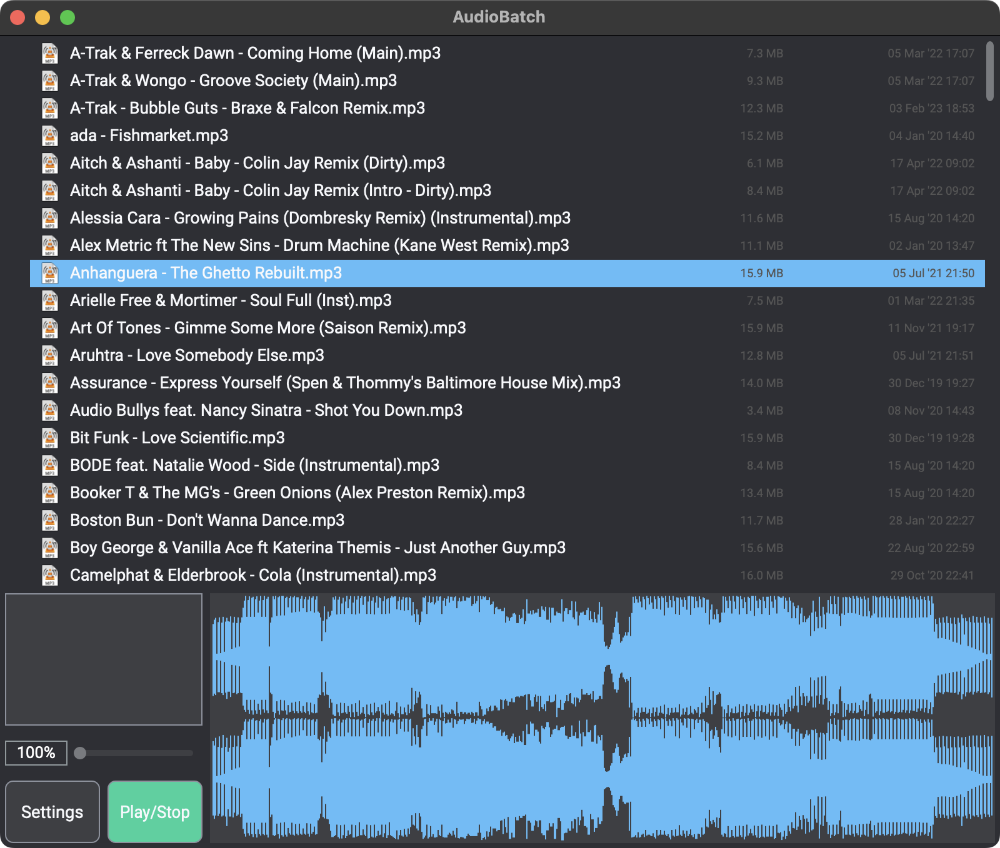

# AudioBatch

GUI and CLI tools (C++23 and JUCE) for analyzing audio files and preparing batch work.

Current implementation focus:

- Analyze audio files and calculate decoded sample peak values.
- Calculate true peak and integrated loudness during analysis.
- Cache analysis results in SQLite so unchanged files are not re-read every run.
- Show sortable peak, true peak, and loudness data in the GUI.
- Show per-file processing state directly in the results list while background work is running.
- Normalize selected files to `0 dBFS` peak from the GUI or the CLI.
- Convert any normalized output to AIFF and preserve all source metadata,
  including embedded album art and custom tags, by writing them back as ID3v2.4.
- Batch process selected files through a chain of VST3 or Audio Unit plugins from the GUI.
- Run the same analysis and normalization from a console executable.

Analysis scope currently assumes mono or stereo source files, including MP3 joint stereo.
Multichannel files are not a target for this tool.



## Dependencies

- [JUCE](https://juce.com/)
- CMake
- SQLite 3
- [libebur128](https://github.com/jiixyj/libebur128)
- [TagLib](https://taglib.org/) for cross-format metadata handling.
- [{fmt}](https://github.com/fmtlib/fmt) for string formatting.

`SQLite3` is resolved through CMake.
If a system `SQLite3` package is available it will be used,
otherwise CMake falls back to fetching the SQLite amalgamation.

`libebur128` is fetched through CMake for loudness and true peak analysis.

`TagLib` is fetched through CMake.
It is used to read every tag and embedded picture from the source file,
and to write the resulting metadata back as ID3v2.4 on the AIFF output.

`{fmt}` is fetched through CMake.
It powers all display and log text formatting through a `utils::format` helper
that works directly with JUCE string and file types.

## Build

For routine development checks,
use the CMake presets to reuse the same build directories as the editor or IDE.

Windows debug with the Visual Studio generator:

```powershell
cmake --preset windows-debug
cmake --build --preset windows-debug
```

Windows debug with Ninja and MSVC, which also produces `compile_commands.json`:

```powershell
cmake --preset windows-ninja-debug
cmake --build --preset windows-ninja-debug
```

macOS debug:

```shell
cmake --preset macos-debug
cmake --build --preset macos-debug
```

`build.sh` is intended for release builds and requires Bash (use Git Bash on Windows):

```shell
./build.sh -b Release
```

This produces two binaries:

- `AudioBatchApp.exe` / `AudioBatch.app` for the GUI app.
- `audiobatch` for CLI binary.

## GUI

The GUI analyzes the selected root folders automatically in the background and stores results in a sortable table.

- `File > Choose Folder...` replaces the current root folders with the chosen folder.
- `File > Add Folder...` appends another root folder and analyzes it without clearing the current results.
  A folder that is already inside a root is skipped,
  and existing roots inside a newly added parent folder are merged into it.
- Dropping folders onto the window replaces the root folders.
  Hold `Shift` while dropping to append them instead.
- `Rescan` and `F5` re-analyze every root folder.

Starting the GUI executable with `-V` or `--version` prints the version line and exits without opening a window,
the same as the CLI:

```text
AudioBatch 0.8.0.12 2026-10-11 ea19fd1 main JUCE v9.0.3
```

The results list supports per-file actions from the context menu, including:

- reveal file in Finder or Explorer
- open the parent folder
- re-analyze selected files
- move files to the system trash
- remove files from the list without deleting them
- normalize selected files to `0 dBFS` peak
- process selected files through the current plugin chain

Keyboard shortcuts in the results list:

- `Delete` or `Backspace` removes the selected rows from the list.
- `Ctrl-Backspace` moves the selected files to the system trash.
- `Cmd-R` or `Ctrl-R` re-analyzes the selected files.
- `F5` refreshes the analysis for all root folders.
- `Space` starts or stops the background analysis.

Normalization works for every readable input format,
including AIFF, WAV, FLAC, MP3, and Ogg Vorbis,
because the output is always a sibling `.aif` file written through the JUCE AIFF writer.

The status column also shows per-file activity while analysis or normalization is running.

Visible columns:

- file name
- full path
- file type
- bitrate
- peak L
- peak R
- peak max
- true peak
- max short
- integrated loudness
- status

Default sorting is by overall peak ascending, so the quietest files appear first.

## Plugin processing

AudioBatch can run selected files through a chain of VST3 or Audio Unit effect plugins
and write the processed audio to disk.

- Use the plugin menu in the GUI to scan for installed plugins and build a chain.
  Plugins are loaded in a separate worker process while scanning,
  so a plugin that crashes during the scan does not take down the app.
  A crashing plugin is blacklisted in the plugin manager, and the scan continues with the next one.
  Adding a plugin opens its editor window automatically so it can be configured.
  Multiple plugin editor windows can be open at the same time.
  Plugin state is captured when an editor window is closed, and again when processing starts,
  and the whole chain is persisted between runs.
- The chain editor window lists the plugins in processing order.
  Individual plugins can be enabled or disabled without removing them from the chain,
  reordered by dragging a row or with the arrow buttons, and removed entirely.
  Removing a plugin closes its editor window.
- Plugins run in offline (non-realtime) rendering mode,
  the same mode DAWs use for bouncing,
  so plugins that offer higher-quality processing for offline rendering use it.
  VST3 plugins receive this through the processing setup,
  and Audio Units through the offline render property.
- Files are processed through the enabled plugins in chain order in a single pass.
  The processing tail is the sum of each plugin's reported tail,
  so reverbs and delays ring out fully through the rest of the chain.
- Plugin latency is compensated.
  The latency each plugin reports, for example from lookahead or linear phase processing,
  is summed over the chain and removed from the start of the output,
  so the processed audio stays aligned with the original and its end is not cut off.
- Processed output is always written as `<name>.aiff` next to the input file.
  If the input has a different extension, the original is moved to the system trash once the new file has been written.
- Source metadata is copied onto the processed AIFF through TagLib,
  so tags and embedded artwork survive the processing step.
- Optional pre-plugin normalization scales each file by `1 / overall peak` before sending it through the chain,
  which keeps the input level consistent across the batch.
  A per-file custom input gain can also be set from the results list.

Normalization always writes an AIFF file next to the source.

- `<name>.aif` sources are normalized in place.
- `<name>.aiff` and `<name>.aifc` sources are rewritten as `<name>.aif`,
  and the original file is moved to the system trash once the write succeeds.
- Any other readable format, including MP3, FLAC, WAV, and Ogg,
  is converted to `<name>.aif` and the original is moved to the system trash.

Metadata is read from the source through TagLib and written back to the AIFF output as ID3v2.4.
This includes standard text tags, custom tags such as ID3v2 `TXXX` frames and Vorbis comment keys,
and embedded pictures such as front cover art.
FLAC Vorbis comments and pictures are translated to the equivalent ID3v2.4 frames on output.

## CLI

The console executable supports both short and long option forms.

Output of `audiobatch --help`:

```text
audiobatch <version> <date> <commit>
Usage: audiobatch [options] <paths...>

Options:
  -h, --help              Print usage and exit
  -V, --version           Print version and exit
  -r, --recurse           Recurse into directories
  -f, --refresh           Ignore cached analysis and re-analyze files
  -n, --normalize         Normalize analyzed files, then report the re-analyzed output peaks
  -j, --jobs <count>      Override worker count
  -s, --sort <mode>       Sort by peak, lufs, name, or path
  -l, --list-plugins      List the available audio plugins and exit
  -g, --group-by <mode>   Group the plugin list by name (alphabetical), manufacturer, type, or format
  -R, --rescan            Scan for new or changed plugins before listing them
```

`--help` and `--version` only print to the console.
They do not start logging or write to the log file.

### Plugin listing

`--list-plugins` prints the VST3 and Audio Unit plugins known to AudioBatch.
It reads the plugin list shared with the GUI from `KnownPlugins.xml` next to the GUI settings file,
so listing is instant and loads no plugins.
CLAP plugins are not listed, because JUCE cannot host them.

- `--group-by name` (default) prints one alphabetical table.
- `--group-by manufacturer`, `type`, or `format` prints one section per group.
  The type is the processing type reported by the plugin, such as Dynamics, EQ, Reverb, or Instrument.
- `-R` / `--rescan` first scans the plugin folders for new or changed plugins
  and removes plugins that no longer exist.
  It uses the same folders as the last scan in the GUI plugin manager, or the default plugin folders.
  Each plugin is loaded in a separate worker process,
  so a plugin that crashes is blacklisted and the scan continues.
  The updated list is saved to `KnownPlugins.xml`,
  which the GUI reloads when the plugin manager opens.
  The GUI settings file is never written by the CLI.
  If the list cannot be saved, the command reports an error and exits with code 1.

```shell
audiobatch --list-plugins
audiobatch -l -g manufacturer
audiobatch -l -R --group-by type
```

Example output:

```text
NAME                     MANUFACTURER     TYPE      FORMAT  VERSION
AnSpec                   Voxengo          Analyzer  VST3    1.2
APU Loudness Compressor  APU Software     Dynamics  VST3    5.0.2
```

```text
Analyzer (19)
  AnSpec                   Voxengo          VST3  1.2
  Correlometer             Voxengo          VST3  1.1
```

Examples:

```shell
audiobatch "music/song.wav"
audiobatch -r -s name "music/library"
audiobatch --recurse --sort peak "music/library"
```

Default CLI output format:

```text
dBFS  dBTP  LUFS-I  TRACK
<peak>  <true peak>  <integrated loudness>  <audio filename>
```

Example output:

```text
  -0.31    -0.17     -8.48  audiofile.wav
```

Normalize mode re-analyzes each output file after rewriting it
and reports the resulting output paths using the same format:

```text
   dBFS     dBTP    LUFS-I  TRACK
  -0.00    -0.00    -10.42  C:\path\to\normalized-output.aif
```

## Cache

Analysis results are cached in a SQLite database
located under the user application data directory in an `AudioBatch/analysis.db` file.

The cache is invalidated when any of these change:

- file path
- file size
- file modification time
- internal analysis schema version

## TODO

- User config file.
- Optional report export, for example CSV or JSON.
