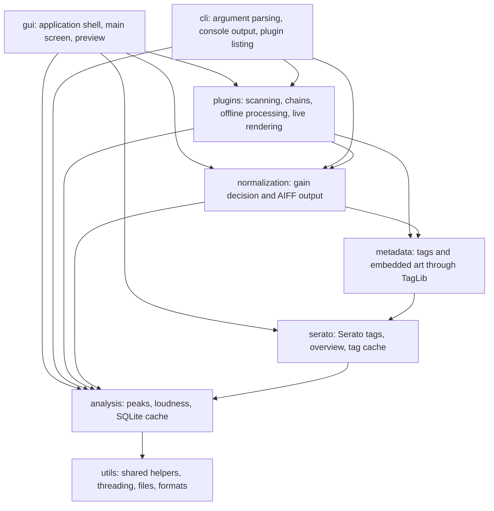
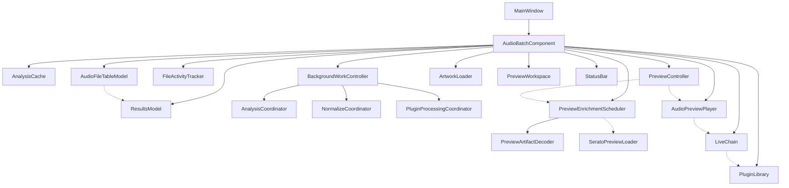
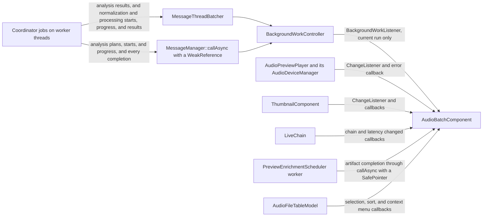
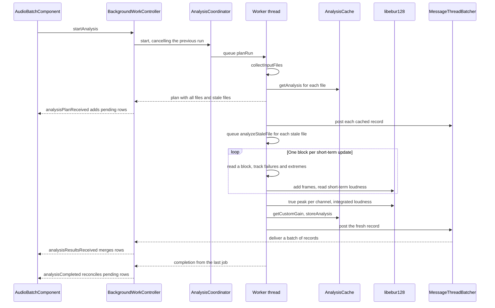
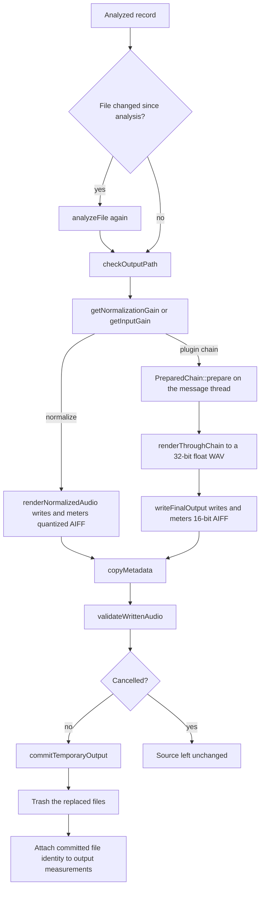
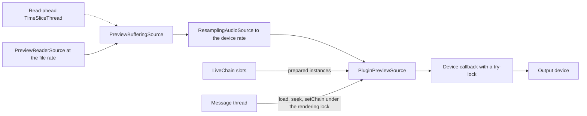
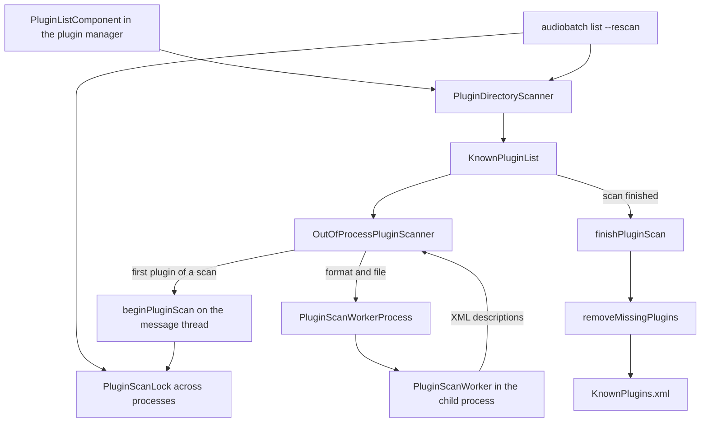

# Architecture

This document describes how the C++23 and JUCE version of AudioBatch is put together.
It analyzes audio files for sample peak, true peak, EBU R128 loudness, and a waveform,
normalizes them to a peak or loudness target as AIFF, processes them through a chain of VST3 or Audio Unit plugins,
and previews them through the live plugin chain.
[`README.md`](README.md) describes the features, and [`AGENTS.md`](AGENTS.md) the file layout and the coding rules.

## Domains and targets

Each directory under `src/` holds one domain, and the domains include each other in one direction only.
Every domain includes `utils`, so the chart only draws that edge once.

`CMakeLists.txt` decides which files each target builds, independently of the directories:

- `AUDIOBATCH_CORE_SOURCES` is the shared core: `analysis`, `metadata`, `normalization`, most of `utils`,
  plugin scanning and offline processing, including native presets and run chains,
  and the Serato tag parsing, overview, and tag cache.
- `AudioBatch` is the GUI app, `AudioBatch.app` or `AudioBatchApp.exe`, made with `juce_add_gui_app`.
  The Windows build target produces `AudioBatch.exe`, which `build.sh` copies as `AudioBatchApp.exe`.
  It adds `gui`, `gui/components`, `PluginPreviewSource`, `SeratoPreviewLoader`, and `SeratoWaveformColouring`,
  and links the JUCE device, GUI, and DSP modules and the embedded fonts.
- `AudioBatchCli` is the console app, made with `juce_add_console_app` with the output name `audiobatch`.
  It adds `AUDIOBATCH_CLI_SOURCES`, which are `cli` and `utils/ConsoleProgress`, and the entry point `CliMain.cpp`.
  It links `juce_audio_processors`, because it relaunches itself as the plugin scan worker for `list --rescan`.
- `AudioBatchTests` links the core, the CLI sources, and the GUI files that have no window of their own,
  such as `BackgroundWorkController`, `AudioPreviewPlayer`, `LiveChain`, and the plugin processing.

Both apps link SQLite, libebur128, TagLib, and {fmt}.
The CLI runs the analysis through `AnalysisCoordinator::analyzeBlocking`,
and normalizes the analyzed files through `NormalizeCoordinator` on the workers `--jobs` sets,
updating the cache with the results once the run completes.
The `process --preset` subcommand renders through a saved chain with `PluginProcessingCoordinator`.
Its main thread runs the JUCE event loop and performs every plugin lifecycle call,
while a worker thread runs the analysis and processing workflow.
`--jobs` sets both the worker pool and the number of chain instances.
The preview is GUI-only.

The CLI's signal handler only sets a lock-free flag on the first interrupt and calls `std::_Exit` on the second.
The workflow polls the flag: blocking analysis cancels and drains its jobs,
and normalization and processing stop starting new files but still reconcile committed outputs.
Interrupted commands return 130.

## GUI structure

`MainWindow` is the top level `DocumentWindow` with the File, Plugins, Options, and Help menus,
whose items and keyboard shortcuts call the same main-view operations.
The Columns submenu reads the table header, and the Output Device submenu lists device and backend pairs.
The Folder column formats its text with `AudioAnalysisFormatting` and sorts by the absolute parent path.
It owns `AudioBatchComponent`, the main view, which owns everything else and wires the parts together:

Solid lines own, and dashed lines only refer to the other object.

- `ResultsModel` holds the rows of the results table with an index from path to row.
  `AudioFileTableModel` is the `TableListBoxModel` that paints and sorts those rows,
  and `FileActivityTracker` holds the per-row activity labels, progress, and messages.
- `BackgroundWorkController` owns the three coordinators and runs one pass at a time.
  Its state is the `BackgroundWork` variant of `IdleWork`, `AnalyzingWork`, `NormalizingWork`, and `ProcessingWork`.
- `PreviewController` holds the `PreviewState` variant of `NoPreview`, `ReleasedPreview`, and `LoadedPreview`.
  It loads the selected file into `AudioPreviewPlayer` and requests artifacts through `PreviewEnrichmentScheduler`.
  The scheduler reuses `SeratoPreviewLoader` parsing and cache helpers on its sole admitted worker.
- `PreviewWorkspace` holds the waveform `ThumbnailComponent`, the metric cards of `AudioInfoPanel`,
  and the playback, gain, normalization, plugin, and settings controls,
  laid out as an expanded section, a wide section whose controls and metrics share half of the width, or a compact row.
  Below its fixed heading and metrics, `AudioInfoPanel` shows a two-row, five-column property grid,
  followed by genre, wrapped album, and wrapped comment tags in one scrollable region.
  Independent vertical dividers resize the controls and information widths within bounded, persisted preferences.
  Key presentation preserves the original tag spelling and appends its Camelot equivalent when recognized.
- `ThumbnailComponent` hosts the Waveform, Spectrogram, side-by-side, and stacked preview modes in one component.
  `PreviewPlotGeometry.h` divides its bounds into panes and axis gutters,
  and maps time to x and back for drawing, cues, and seeking in every pane.
  `ThumbnailComponentSpectrogram.cpp` builds one colourized raster per spectral artifact and draws the frequency axis,
  and `ThumbnailComponentOverloads.cpp` draws the outer-edge overload caps and their optional lines.
  A press latches its pane and moves only a grey target cursor. The release seeks once.
- `LiveChain` holds the plugin slots of the chain, its persistence and presets, and the editor and manager windows.

`AudioBatchComponent` is split into topic files that share `AudioBatchComponentConstants.h`:
`AudioBatchComponent.cpp` for construction, the table, selection, and status,
`AudioBatchComponentActions.cpp` for keys, the context menu, removing, re-analyzing, and trashing,
`AudioBatchComponentLayout.cpp` for the layout and the collapse animation,
`AudioBatchComponentOperations.cpp` for starting passes and applying their results,
`AudioBatchComponentPreview.cpp` for the preview, the waveform, and the custom gain,
and `AudioBatchComponentRoots.cpp` for root folders, drops, and rescans.

Events reach the main component through a few channels, all of which end on the message thread:

The coordinators publish through `RunCallback`, which copies the callback under a lock and calls it without the lock.
`BackgroundWorkController` posts each event to the message thread,
drops events whose run id is not the current one,
and calls the `BackgroundWorkListener` that `AudioBatchComponent` implements.
Analysis results go through one `MessageThreadBatcher`, so a burst of cached results costs one table refresh.
Each normalization or processing pass has its own batcher for the starts, progress reports, and results of its files,
so a burst of results costs one sort and one table refresh, and a start never overtakes the result of its file.
Every completion delivers what its batcher still holds first.
A normalization or processing result is still passed on after its pass ended, because its file was already written.

## Threads

- **The message thread** runs the GUI, starts and cancels passes, and applies results to the table.
  Cache persistence runs on workers.
  The message thread also does every plugin lifecycle step: creating, preparing, releasing, and destroying instances.
- **`BackgroundRunner` pools.** Each coordinator owns one `BackgroundRunner` with its own `juce::ThreadPool`.
  Analysis and normalization use one worker per logical core,
  and plugin processing one per physical core minus one, from `getPluginProcessingWorkerCount`.
  A job captures the current run id when it is queued, and polls `makeCancellationCheck` between blocks.
  `publish` only delivers a callback while the run id is still current.
- **Cancel versus stop.** `cancel` increments the run id, drops the queued jobs,
  and leaves the running ones to stop at their next check, so nothing of that run is published anymore.
  `requestStop` keeps the run current and only marks it as stopped.
  Its jobs stop at their next check, files not yet committed are published as cancelled,
  results of files committed just before still arrive, and so does the completion.
  The Cancel action cancels an analysis, and requests a stop of a normalization or processing pass.
  Clear All Files cancels every coordinator through `stopAllWork`.
  On shutdown, `cancelAndWait` waits up to 30 seconds for analysis and normalization jobs,
  and up to 60 seconds for plugin jobs.
  The analysis and normalization destructors then wait without a timeout to keep their state alive for remaining jobs.
  When a plugin job is still running after that,
  the `PluginProcessingCoordinator` destructor ends the process instead of waiting for a hung plugin.
- **`callOnMessageThread`** lets a plugin worker run a step on the message thread and wait for it.
  The wait gives up when the run is cancelled before the call started,
  so `cancelAndWait` on the message thread never deadlocks against a worker that waits for it.
- **The audio device callback** of `AudioPreviewPlayer` renders the preview.
  It only try-locks the rendering lock and outputs silence for any block in which the lock is busy.
- **The read-ahead thread** is the `TimeSliceThread` of `AudioPreviewPlayer`,
  which fills the `BufferingAudioSource` from the file, so the audio callback never decodes.
- **Preview enrichment.** `PreviewEnrichmentScheduler` owns one worker and a separate cache connection.
  It loads selected cached artifacts during foreground work, then repairs missing Serato tags,
  native waveforms, and spectrograms only after measurement results and restored selection settle.
  Selection takes priority, and cancellation is checked between bounded PCM blocks.
  `PreviewArtifactDecoder` decodes once for every missing audio artifact,
  feeding the `analysis/` `NativeWaveformBuilder` and `SpectrogramBuilder` without a loudness meter.
  The waveform builder serializes JUCE thumbnails directly, without source-backed `AudioThumbnailCache` decoding.
  Coalesced explicit gain edits and committed output persistence share the worker, ahead of optional repair.
  Shutdown cancels artifact publication without joining a worker against UI delivery.
- **Other small workers.** `ArtworkLoader` reads and decodes bounded artwork thumbnails with one active
  and one replaceable pending request.
  `AudioBatchComponent` prunes cache rows of deleted files on another `std::jthread` after startup.
- **Plugin scanning** runs on the single scan thread of the plugin manager's `PluginListComponent`.
  Each plugin is loaded in a separate worker process, which scans on its own message thread.

Plugin instances belong to the message thread in every case.
The live slots of `LiveChain` own the processors that the preview and the editors share,
and their `processBlock` runs on the audio device thread.
`PluginLibrary::instantiateChains` creates one chain per processing worker on the message thread,
and `PluginRunChains` leases one chain at a time to a worker, which calls `processBlock` on its own thread.
The destructor of `PluginRunChains` posts the instances back to the message thread when a worker releases them last.

## Analysis

`AnalysisCoordinator::start` plans the run on a worker, so the message thread never waits for the file system.
The cache key is the file path, and a cached row only counts while source size, modification time,
and the coordinated measurement contract still match.
Both applications read and write `file_analysis` in the main AudioBatch `analysis.db`.
On macOS it lives at `~/Library/AudioBatch/analysis.db`, and on Windows at `%APPDATA%\\AudioBatch\\analysis.db`.
Contract version 16 accepts either producer's successful measurements with validated stream geometry,
histories, and source statistics.
The nullable source scalars are plain columns,
and `dc_offsets` and `clip_counts` hold one little-endian `f64` or `u64` per channel.
A source with a NaN or infinite sample fails analysis as unsupported PCM,
so normalization and plugin rendering never see non-finite input.
The loudness-history and `OVLD` overload encodings are shared, but decoder failures remain producer-specific.
Older measurements refill to collect required source statistics without discarding gains or compatible previews.
Unknown or malformed required measurements refill normally.
Same-source UPSERTs preserve the database's latest gain, including explicit clears, and compatible native artifacts.
Gain and artifact writes never change the producer of the measurements.
The GUI shows `Cached (Rust)` for Rust measurements and plain `Cached` for its own, with CLI output unchanged.
Foreign overload histories describe the originating decoder's measured source, not bit-identical local lossy playback.

The optional JUCE waveform remains separate from Rust's `rust_waveform_cache` representation.
Both applications share the `spectrogram_cache` table, keyed by path, algorithm revision, and serialization revision.
Its rows record source identity, stream geometry, and the producing application,
and hold the bounded little-endian `SPEC` codec of `SpectrogramData`, with at most 4096 by 512 intensity bytes.
`AnalysisCacheSpectrogram.cpp` publishes only against matching successful measurement geometry,
and removes incompatible rows only after the measurement commit.
Measurement lookups do not load waveform or spectral blobs, and missing native waveforms, spectrograms,
or corrupt Serato cache payloads are artifact misses rather than measurement misses.
Post-load enrichment uses one active expensive job per app, with selected-file priority,
stable negative Serato outcomes, identity-conditional publication, and foreground-operation cancellation.
Cache reads enforce payload bounds,
and short WAL transactions keep decoding and metadata parsing outside database locks.
Potentially blocking gain and preview persistence runs outside the GUI thread and the audio callback.
Settings, logs, and plugin data remain application-specific.

- `analyzeFile` opens the file with `createAudioReader`, which uses a per-thread format manager
  and corrects the length of MP3 files without a Xing header.
- `AudioMeasurement` sets up libebur128 for integrated loudness, short-term loudness, and true peak,
  and measures a mono file as dual mono, so it reads as loud as the same content in stereo.
  It reserves short-term history storage from the declared frame count and fixed update interval.
- It accepts planar chunks from decoding or PCM output writing and measures fixed intervals,
  borrowing complete intervals and buffering only those that cross chunk boundaries.
  Its final reduction supplies the same record fields to all three services.
  Fixed per-channel online moments collect the DC means, unweighted energy, full-scale counts,
  and centered stereo covariance in the same pass, without retaining audio.
  The final reduction derives PLR, PSR, and crest factor from them and the peak and loudness results.
- `measureDecodedAudio` reads blocks of a tenth of a second, which keeps the short-term loudness history at 10 Hz.
  `DecodeFailureTracker` tolerates a failed final block and isolated failed blocks,
  and fails the file after three failed blocks in a row.
- Each block also sets per-channel source overload flags in `OverloadHistoryBuilder`:
  a sample over for a decoded sample whose magnitude exceeds 1.0,
  and a true peak over when `ebur128_prev_true_peak` reports more than 1.0 for that block's meter call.
  The history keeps at most 8192 buckets by merging neighbours with a bitwise or,
  and the cache stores it as a versioned blob beside the short-term loudness.
  A missing or malformed blob on a successful row makes the file analyze again.
  `ThumbnailComponent` draws them as compact caps on the outer waveform edges,
  yellow for sample overs and orange for true peak overs, with optional subdued vertical lines.
  They describe the source, so the gain and the plugin preview leave them unchanged.
- The same fixed intervals feed the `analysis/` `NativeWaveformBuilder` and `SpectrogramBuilder`,
  so fresh analysis builds the complete waveform and spectrogram in its single decode pass.
  The spectrogram uses a 4096-point symmetric Hann STFT with a 1024-frame hop, averages channel powers,
  keeps the maximum power within each of 512 mel rows,
  and merges adjacent time columns in place to stay within 4096 columns.
  Both artifacts are optional, so their failures never fail the measurement.
  `AnalysisCoordinator` persists them before publishing the lighter record without them.
  For the selected file, `AnalysisCoordinatorPreview.cpp` publishes a throttled `AnalysisPreview` waveform snapshot,
  keeping only the latest one, rejecting stale runs and selections, and never persisting it.
- The sample peaks keep their sign, and the overall values take the channel with the largest magnitude.
- `storeAnalysis` keeps only failures that would repeat for the same bytes, so the next run retries the others.
- Cached measurements from older runs may lack the waveform or spectrogram.
  `PreviewController` routes selected artifact requests to the shared enrichment admission policy.
  `getWaveformData` and `getSpectrogramData` load cached artifacts on the worker,
  and `PreviewArtifactDecoder` fills only the missing ones.
  Identity-conditional `storeWaveformData` and `storeSpectrogramData` persist only the artifact.
  Selected adoption changes neither transport nor gain, histories, operation messages, or measurement provenance.

## Normalization and processing

Normalization and plugin processing share the start of the pipeline and everything after rendering.
Both write `<name>.aif` next to the source and measure the exact quantized PCM while writing it.
Batch conflict detection prepares destination paths before sorting,
then assigns normalized destination keys through sets, with in-place sources taking priority.
Each in-place backup owns its File value and temporary folder,
so concurrent backup calls do not share mutable path-encoding storage.
The committed file's identity is attached to those measurements for the new table row,
without decoding the output again.
Its native file identity must still match the rendered temporary file after commit,
so a replacement or modification cannot receive measurements of different bytes.

**The gain decision.** `getNormalizationGain` returns the gain to the target sample peak,
or in loudness mode the gain to the target loudness, lowered so the true peak stays under the ceiling.
It refuses a silent file and a gain above 40 dB instead of capping it.
For plugin processing, `getInputGain` applies the file's custom gain when it has one,
then the normalization gain when Normalize is on, and unity gain with a notice when normalization refuses the file.
An in-place `.aif` file whose gain is within 1.5 output PCM steps of unity is not rewritten.
Its current analysis is reused after cancellation and file-identity checks,
and a stale source is analyzed only once before making the gain decision.
Foreign measurements are also remeasured natively before target gain, silence or excessive-gain refusal,
true-peak ceiling, and in-place no-op decisions.
An unchanged source keeps its custom gain and gains native measurement provenance even when no rewrite is needed.
Explicit custom-gain and unity plugin paths do not remeasure solely because the origin is foreign.

**Normalization rendering.** `normalizeFile` streams the source in blocks of 32768 samples,
applies the gain, and writes AIFF at the source sample rate.
Reusable integer buffers preserve JUCE's float-writer rounding and full-scale saturation,
while the meter receives the exact samples a JUCE AIFF reader would decode at the output bit depth.
`getNormalizationOutputBitDepth` keeps the source bit depth when the AIFF writer supports it,
uses 16 bits for MP3, and otherwise the deepest supported depth, so 32-bit float becomes 24-bit.

**Plugin rendering.** `processFileWithPlugins` refuses files with more than two channels.

- `PreparedChain::prepare` runs `prepareChain` on the message thread through `callOnMessageThread`,
  because VST3 restricts bus layout, setup, activation, and state to the UI thread.
  For each plugin it sets the main buses to the file's layout with a stereo fallback for mono files,
  switches to offline rendering, restores the saved state, prepares for blocks of 1024 samples, and resets.
  Audio Units get their state after `prepareToPlay` instead of before.
  The destructor of `PreparedChain` releases the chain on the message thread again.
- `renderThroughChain` renders the file length plus the summed latency and the summed tails,
  each tail clamped to 20 seconds, and pads the last block with silence to the full block size.
- `processBlockThroughChain` routes the channels between plugins.
  A mono signal is copied to both inputs of a stereo plugin, a stereo signal is averaged into a mono plugin,
  extra channels such as a sidechain are cleared, and each plugin sees a buffer view of only its own channels.
- After each block, `findFailedProcessCall` fails the file when a VST3 plugin reported a failed process call,
  and non-finite samples fail it too.
- The first latency samples are skipped, so the output lines up with the source,
  and a mono file is written as the average of the chain's two output channels.
- `writeFinalOutput` trims the trailing silence below -96 dB but never makes the output shorter than the source.
  It quantizes to 16 bits by truncation, saturates samples outside the range, and reports clipping in the notice.
  It adds no dither and no gain reduction.
  The same quantized PCM feeds `AudioMeasurement` for the final retained length.
  The float intermediate remains necessary to establish the audible tail before the final output is written.

**Metadata, validation, and commit.** `copyMetadata` copies the tags, the pictures,
and the opaque ID3v2 frames onto the output as ID3v2.4, and drops the Serato overview.
A source that cannot be opened, or tags that cannot be written, fail the file before anything is committed.
A source in a format TagLib does not read is processed without tags.
`validateWrittenAudio` opens the output and checks its channel count, sample rate, and length,
without decoding its audio samples.
After a last cancellation check, `disposeOfCopy` trashes a copy of an `.aif` source that is rewritten in place.
`commitTemporaryOutput` retains an approved existing output under a hidden hard-link backup before vacating its path.
For conversions, it claims the output with a hard link that cannot replace a concurrent occupant,
then disposes of the source. In-place writes use JUCE's `replaceFileIn`.
Rollback removes or restores only entries whose native identities still belong to the transaction.
If recovery cannot restore the output, the rendered audio is retained and its location is reported.
A backup that cannot be disposed of after successful publication is retained with a warning.
These checks narrow stale-file races.
Path-based replacement and disposal are not atomic compare-and-swap operations.
Conversions require a filesystem that supports hard links.
The `disposeFile` option moves files to the trash, and tests replace it with a delete.
The outcome is `OperationSucceeded`, `CommittedButUnanalyzed`
when the committed output cannot be opened or no longer matches the rendered file identity,
or `OperationFailed` before a successful commit.
Failures normally keep the source untouched, with recovery paths retaining rendered audio when publication fails.

## Preview

`AudioPreviewPlayer` plays one file through a fixed chain of audio sources:

- **The rendering lock** is a `CriticalSection` that the player shares with `LiveChain`.
  The message thread holds it to load, release, seek, and replace the chain.
  The device callback only try-locks it, and the player publishes position and state in atomics,
  so the waveform and the buttons read them without the lock.
- **Device preparation.** `audioDeviceAboutToStart` only records the new rate and block size.
  `handleAsyncUpdate` then prepares the input and the plugins on the message thread at that rate,
  and `deviceReady` keeps the callback silent until it has.
- **The live chain.** `LiveChain::preparePreview` creates slot instances lazily on the message thread,
  prepares them in real-time mode at the device rate, and prefers a stereo layout with a mono fallback.
  The chain always runs in stereo.
  A mono file is copied into a stereo plugin, and its output is averaged back to mono, like the processed file.
  The custom gain of the file is applied in front of the chain with a 5 ms ramp,
  and only while the chain is on and has at least one enabled plugin.
- **Latency pre-roll.** With compensation on, `PluginPreviewSource` runs the chain silently for the chain latency
  after every start and seek, so the audio lines up with the waveform position.
- **Tail drain.** Rendering continues past the end of the file for the latency and the tails,
  with the position held at the end, and stopping or seeking discards the old tail.
- **Fades.** A start fades in over 64 samples, and a stop fades out over 64 samples.
  A stop during the pre-roll is immediate.
- **Failures.** `updatePlaybackStatus` runs on a 50 ms timer and on every display frame through the waveform.
  It stops playback and reports a read failure, a buffer underrun, a failed VST3 process call, or non-finite output.
- **Device policy.** The output device opens on the first play with output channels only,
  restoring the device saved by the last session.
  `release` stops the source and closes the file but keeps the device open,
  so switching files while playing does not reopen it.
  `updatePlaybackStatus` closes the device once nothing plays and no stop fade is left,
  unless the Audio Settings window holds it while the app is active.
  On Windows, losing the foreground suspends playback and closes the device.
  Windows playback uses ASIO only.
  An unconfigured ASIO host tries other registered outputs when its default driver has no connected device.
  A saved or current selection is retained instead of switching interfaces when it fails to open.
  A failed device open blocks focus-driven retries until the user explicitly reopens settings or starts playback,
  so dismissing the error does not create another device-error dialog.

## Plugin hosting

`addPluginFormats` registers an Audio Unit format that leaves the Audio Units built into macOS out of every scan,
and a VST3 format that splits `VST3_PATH` with the platform path separator.

- `PluginLibrary` installs `OutOfProcessPluginScanner` as the custom scanner of its `KnownPluginList`.
  The scanner launches the app's own executable with the worker command line,
  which `gui/Main.cpp` and `cli/CliMain.cpp` check for before anything else.
  The worker loads the plugin on its message thread, because copy-protected plugins need it, and replies with XML.
- A worker that crashes makes the scan return false, and `KnownPluginList` blacklists the plugin.
  A plugin that takes longer than 180 seconds is skipped without blacklisting, and its worker is dropped.
  Cancelling the scan drops the worker too.
- The first plugin of a scan calls `beginPluginScan`, which takes the inter-process `PluginScanLock`
  and reloads the list from `KnownPlugins.xml`, so a GUI scan builds on a CLI rescan.
  When the CLI holds the lock, the GUI abandons the scan without blacklisting anything and tells the user.
  The CLI refuses to rescan while the GUI holds the lock.
- After a scan that ran to its end, `removeMissingPlugins` drops the plugins and blacklist entries of deleted files.
  It only looks inside searched folders that still exist.
  A cancelled scan removes nothing, and plugins on a missing drive stay listed.
- `PluginLibrary` saves the list to `KnownPlugins.xml` next to the settings file,
  and moves a list that older versions kept in the settings into that file.

**Chain and presets.** `LiveChain` keeps the chain in the settings under `pluginChain`,
as the XML that `plugin_presets::createChainXml` makes from `SavedChainSlot` values:
the plugin description, the enabled flag, and the plugin state.
`persistChain` captures the state of every prepared slot first, also from slots whose editor is closed.
Presets are the same XML, one file per preset in the `Chain Presets` folder next to the settings file.
Loading a preset replaces the slots, which create their processors lazily,
so a plugin that is not installed shows as unavailable instead of failing the load.
A processing run copies the current state of every enabled slot,
and a plugin without saved state is reset to the state it had right after it was created before every file.

**JUCE fork patches.** JUCE comes from the [Esgrove/JUCE](https://github.com/Esgrove/JUCE) fork,
with project-specific fixes for plugin hosting.
Two hosting extensions are used by the application,
and they live in JUCE because the code they change is private to JUCE's hosting classes:

- *Let a custom plugin scanner abandon a scan.* `PluginListComponent` only stopped a cancelled scan between files,
  so a custom scanner waiting on a hung plugin never learned about it,
  and a scanner that could not run at all made every remaining file count as failed.
  `CustomScanner::abandonScan` and `KnownPluginList::cancelCustomScan` now make `shouldExit` return true,
  and `PluginDirectoryScanner` stops without reporting the unscanned files as failed.
  `OutOfProcessPluginScanner` polls `shouldExit` while it waits for the worker,
  and calls `abandonScan` when the scan lock is taken.
- *Report the result of the last VST3 process call.* `VST3PluginInstance` ignored the result of `process`,
  so a host could not tell when a plugin reported a failure and kept using its output.
  `VST3Client::getLastProcessResult` now returns it, which `findFailedProcessCall` checks after every block,
  both in offline processing and in the preview.

## Differences from the Rust version

The Rust version in [`../rust`](../rust/README.md) follows the same behaviour where the two are compared,
and the root README lists the user facing differences under
[Differences between the versions](../README.md#differences-between-the-versions).
The deliberate differences are these:

- Only the C++ version hosts Audio Unit plugins.
  The Rust version hosts VST3 only, through its own `vst3-host` crate.
- Only the C++ GUI has the results context menu.
  Its file chooser selects folders, but drops and launch arguments accept individual files too.
- Both versions share measurements and compatible Serato outcomes in the main AudioBatch analysis database.
  Each keeps its own plugin list, chain, presets, settings, and logs,
  because the chain state JUCE saves and its plugin ids are specific to JUCE.
- The Rust version builds its native waveform overview in the analysis pass.
  The C++ version uses the JUCE thumbnail representation.
  Both native waveform artifacts can coexist, and each GUI fills its missing artifacts after initial loading.
- The Rust preview decodes on its own thread into a ring buffer that the `cpal` callback reads,
  where the C++ preview reads through `BufferingAudioSource` and `ResamplingAudioSource`.
