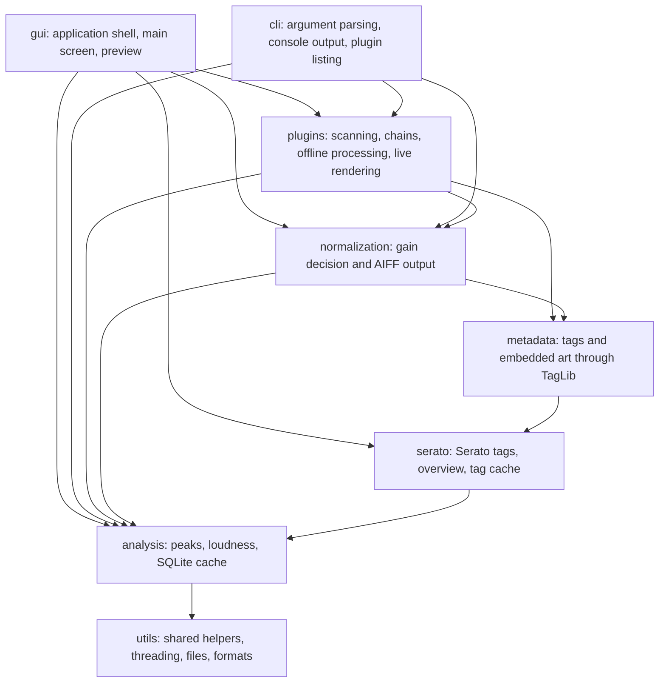
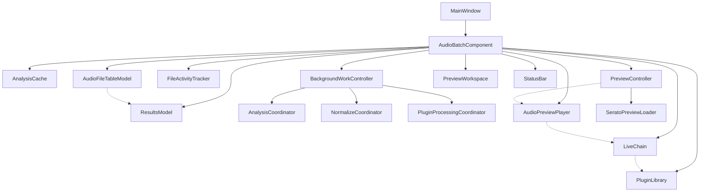
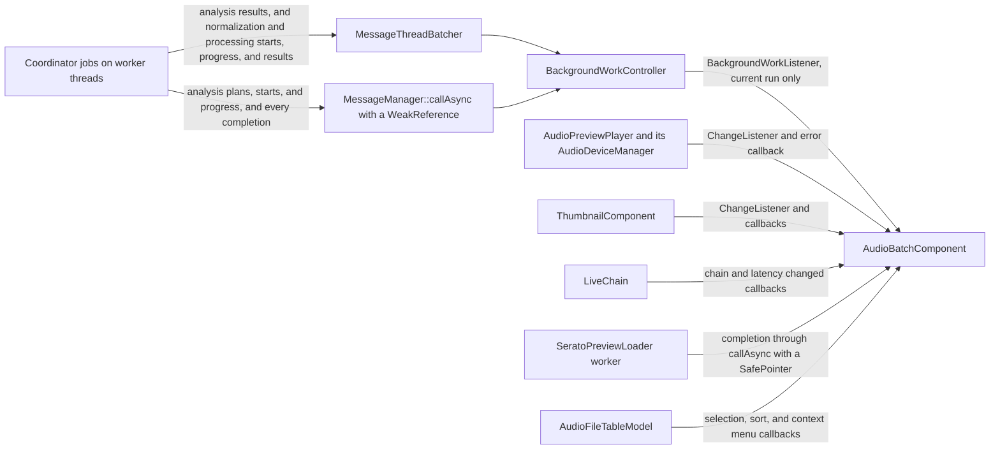
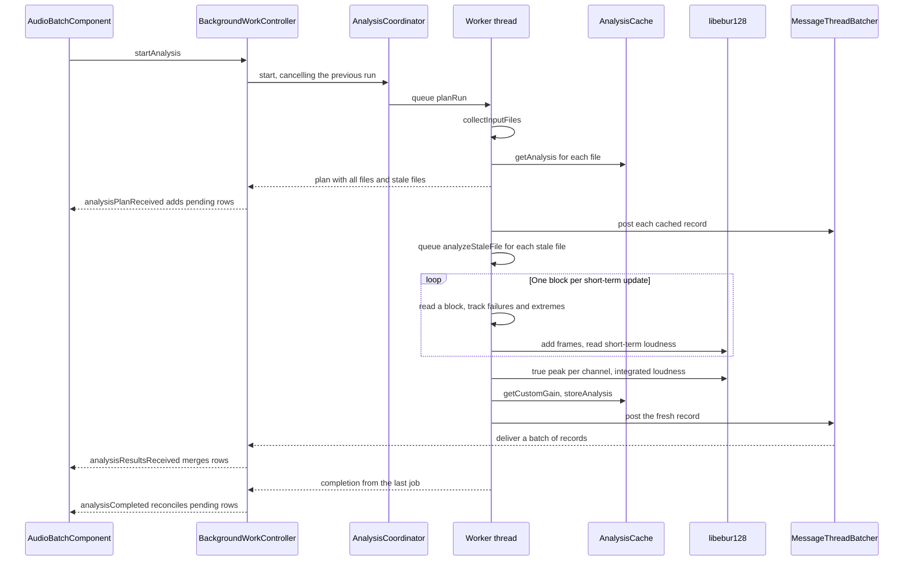
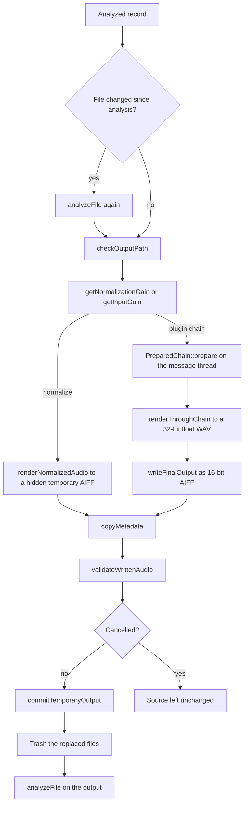
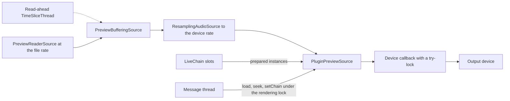
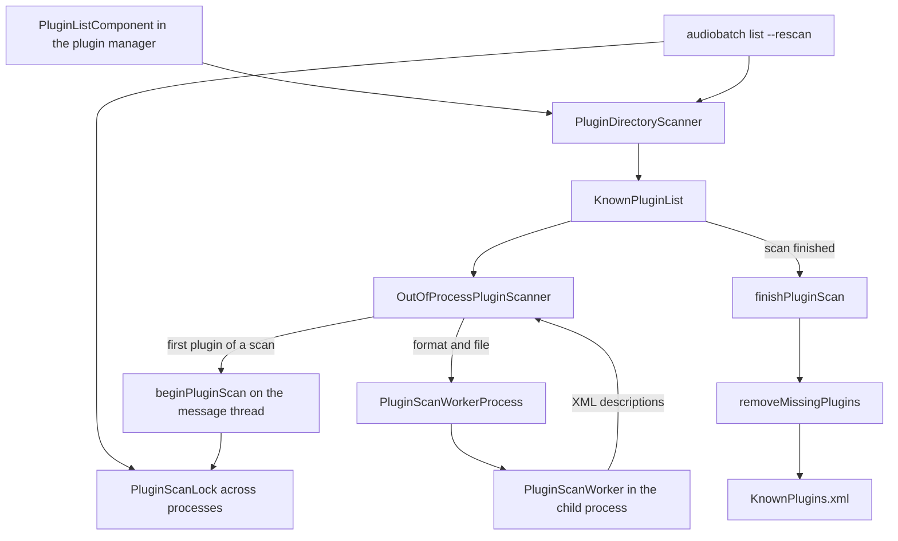

# Architecture

This document describes how the C++23 and JUCE version of AudioBatch is put together.
It analyzes audio files for sample peak, true peak, EBU R128 loudness, and a waveform,
normalizes them to a peak or loudness target as AIFF, processes them through a chain of VST3 or Audio Unit plugins,
and previews them through the live plugin chain.
[`README.md`](README.md) describes the features, and [`AGENTS.md`](AGENTS.md) the file layout and the coding rules.

## Domains and targets

Each directory under `src/` holds one domain, and the domains include each other in one direction only.
Every domain includes `utils`, so the chart only draws that edge once.

`CMakeLists.txt` decides which files each target builds, independently of the directories:

- `AUDIOBATCH_CORE_SOURCES` is the shared core: `analysis`, `metadata`, `normalization`, most of `utils`,
  `PluginScanner`, and the Serato tag parsing, overview, and tag cache.
- `AudioBatch` is the GUI app, `AudioBatch.app` or `AudioBatchApp.exe`, made with `juce_add_gui_app`.
  It adds `gui`, `gui/components`, the rest of `plugins`, `SeratoPreviewLoader`, and `SeratoWaveformColouring`,
  and links the JUCE device, GUI, and DSP modules and the embedded fonts.
- `AudioBatchCli` is the console app, made with `juce_add_console_app` with the output name `audiobatch`.
  It adds `AUDIOBATCH_CLI_SOURCES`, which are `cli` and `utils/ConsoleProgress`, and the entry point `CliMain.cpp`.
  It links `juce_audio_processors`, because it relaunches itself as the plugin scan worker for `list --rescan`.
- `AudioBatchTests` links the core, the CLI sources, and the GUI files that have no window of their own,
  such as `BackgroundWorkController`, `AudioPreviewPlayer`, `LiveChain`, and the plugin processing.

Both apps link SQLite, libebur128, TagLib, and {fmt}.
The CLI runs the analysis through `AnalysisCoordinator::analyzeBlocking`,
and normalizes the analyzed files through `NormalizeCoordinator` on the workers `--jobs` sets,
updating the cache with the results once the run completes.
Plugin processing and the preview exist only in the GUI.

## GUI structure

`MainWindow` is the top level `DocumentWindow` with the menu bar and the application commands.
It owns `AudioBatchComponent`, the main view, which owns everything else and wires the parts together:

Solid lines own, and dashed lines only refer to the other object.

- `ResultsModel` holds the rows of the results table with an index from path to row.
  `AudioFileTableModel` is the `TableListBoxModel` that paints and sorts those rows,
  and `FileActivityTracker` holds the per-row activity labels, progress, and messages.
- `BackgroundWorkController` owns the three coordinators and runs one pass at a time.
  Its state is the `BackgroundWork` variant of `IdleWork`, `AnalyzingWork`, `NormalizingWork`, and `ProcessingWork`.
- `PreviewController` holds the `PreviewState` variant of `NoPreview`, `ReleasedPreview`, and `LoadedPreview`.
  It loads the selected file into `AudioPreviewPlayer` and asks `SeratoPreviewLoader` for its Serato tags.
- `PreviewWorkspace` holds the waveform `ThumbnailComponent`, the metric cards of `AudioInfoPanel`,
  and the playback, gain, normalization, plugin, and settings controls,
  laid out as an expanded section or a compact row.
- `LiveChain` holds the plugin slots of the chain, its persistence and presets, and the editor and manager windows.

`AudioBatchComponent` is split into topic files that share `AudioBatchComponentConstants.h`:
`AudioBatchComponent.cpp` for construction, the table, selection, and status,
`AudioBatchComponentActions.cpp` for keys, the context menu, removing, re-analyzing, and trashing,
`AudioBatchComponentLayout.cpp` for the layout and the collapse animation,
`AudioBatchComponentOperations.cpp` for starting passes and applying their results,
`AudioBatchComponentPreview.cpp` for the preview, the waveform, and the custom gain,
and `AudioBatchComponentRoots.cpp` for root folders, drops, and rescans.

Events reach the main component through a few channels, all of which end on the message thread:

The coordinators publish through `RunCallback`, which copies the callback under a lock and calls it without the lock.
`BackgroundWorkController` posts each event to the message thread,
drops events whose run id is not the current one,
and calls the `BackgroundWorkListener` that `AudioBatchComponent` implements.
Analysis results go through one `MessageThreadBatcher`, so a burst of cached results costs one table refresh.
Each normalization or processing pass has its own batcher for the starts, progress reports, and results of its files,
so a burst of results costs one sort and one table refresh, and a start never overtakes the result of its file.
Every completion delivers what its batcher still holds first.
A normalization or processing result is still passed on after its pass ended, because its file was already written.

## Threads

- **The message thread** runs the GUI, starts and cancels passes, applies results to the table and the cache,
  and does every plugin lifecycle step: creating, preparing, releasing, and destroying instances.
- **`BackgroundRunner` pools.** Each coordinator owns one `BackgroundRunner` with its own `juce::ThreadPool`.
  Analysis and normalization use one worker per logical core,
  and plugin processing one per physical core minus one, from `getPluginProcessingWorkerCount`.
  A job captures the current run id when it is queued, and polls `makeCancellationCheck` between blocks.
  `publish` only delivers a callback while the run id is still current.
- **Cancel versus stop.** `cancel` increments the run id, drops the queued jobs,
  and leaves the running ones to stop at their next check, so nothing of that run is published anymore.
  `requestStop` keeps the run current and only marks it as stopped.
  Its jobs stop at their next check, files not yet committed are published as cancelled,
  results of files committed just before still arrive, and so does the completion.
  The Cancel action cancels an analysis, and requests a stop of a normalization or processing pass.
  Clear All Files cancels every coordinator through `stopAllWork`.
  On shutdown, `cancelAndWait` waits up to 30 seconds for analysis and normalization jobs,
  and up to 60 seconds for plugin jobs.
  When a plugin job is still running after that,
  the `PluginProcessingCoordinator` destructor ends the process instead of waiting for a hung plugin.
- **`callOnMessageThread`** lets a plugin worker run a step on the message thread and wait for it.
  The wait gives up when the run is cancelled before the call started,
  so `cancelAndWait` on the message thread never deadlocks against a worker that waits for it.
- **The audio device callback** of `AudioPreviewPlayer` renders the preview.
  It only try-locks the rendering lock and outputs silence for any block in which the lock is busy.
- **The read-ahead thread** is the `TimeSliceThread` of `AudioPreviewPlayer`,
  which fills the `BufferingAudioSource` from the file, so the audio callback never decodes.
- **Smaller workers.** The `AudioThumbnailCache` of `ThumbnailComponent` builds the waveform on its own JUCE thread.
  `SeratoPreviewLoader` reads Serato tags on a `std::jthread` with one active and one replaceable pending request,
  and `AudioBatchComponent` prunes cache rows of deleted files on another `std::jthread` after startup.
- **Plugin scanning** runs on the single scan thread of the plugin manager's `PluginListComponent`.
  Each plugin is loaded in a separate worker process, which scans on its own message thread.

Plugin instances belong to the message thread in every case.
The live slots of `LiveChain` own the processors that the preview and the editors share,
and their `processBlock` runs on the audio device thread.
`PluginLibrary::instantiateChains` creates one chain per processing worker on the message thread,
and `PluginRunChains` leases one chain at a time to a worker, which calls `processBlock` on its own thread.
The destructor of `PluginRunChains` posts the instances back to the message thread when a worker releases them last.

## Analysis

`AnalysisCoordinator::start` plans the run on a worker, so the message thread never waits for the file system.
The cache key is the file path, and a cached row only counts while the file size, the modification time,
and the analysis version still match.

- `analyzeFile` opens the file with `createAudioReader`, which uses a per-thread format manager
  and corrects the length of MP3 files without a Xing header.
- `createLoudnessState` sets up libebur128 for integrated loudness, short-term loudness, and true peak,
  and measures a mono file as dual mono, so it reads as loud as the same content in stereo.
- `measureDecodedAudio` reads blocks of a tenth of a second, which keeps the short-term loudness history at 10 Hz.
  `DecodeFailureTracker` tolerates a failed final block and isolated failed blocks,
  and fails the file after three failed blocks in a row.
- The sample peaks keep their sign, and the overall values take the channel with the largest magnitude.
- `storeAnalysis` keeps only failures that would repeat for the same bytes, so the next run retries the others.
- The waveform is not part of the analysis.
  `showAudioFile` loads it from the cache with `getWaveformData`, or lets `juce::AudioThumbnail` read the file,
  and `handleThumbnailFullyLoaded` stores the finished thumbnail with `storeWaveformData`.

## Normalization and processing

Normalization and plugin processing share the start of the pipeline and everything after rendering.
Both write `<name>.aif` next to the source, and both re-analyze the output for the new table row.

**The gain decision.** `getNormalizationGain` returns the gain to the target sample peak,
or in loudness mode the gain to the target loudness, lowered so the true peak stays under the ceiling.
It refuses a silent file and a gain above 40 dB instead of capping it.
For plugin processing, `getInputGain` applies the file's custom gain when it has one,
then the normalization gain when Normalize is on, and unity gain with a notice when normalization refuses the file.
An `.aif` file that is already at its target is not rewritten, and only analyzed again.

**Normalization rendering.** `normalizeFile` streams the source in blocks of 32768 samples,
applies the gain, and writes AIFF at the source sample rate.
`getNormalizationOutputBitDepth` keeps the source bit depth when the AIFF writer supports it,
uses 16 bits for MP3, and otherwise the deepest supported depth, so 32-bit float becomes 24-bit.

**Plugin rendering.** `processFileWithPlugins` refuses files with more than two channels.

- `PreparedChain::prepare` runs `prepareChain` on the message thread through `callOnMessageThread`,
  because VST3 restricts bus layout, setup, activation, and state to the UI thread.
  For each plugin it sets the main buses to the file's layout with a stereo fallback for mono files,
  switches to offline rendering, restores the saved state, prepares for blocks of 1024 samples, and resets.
  Audio Units get their state after `prepareToPlay` instead of before.
  The destructor of `PreparedChain` releases the chain on the message thread again.
- `renderThroughChain` renders the file length plus the summed latency and the summed tails,
  each tail clamped to 20 seconds, and pads the last block with silence to the full block size.
- `processBlockThroughChain` routes the channels between plugins.
  A mono signal is copied to both inputs of a stereo plugin, a stereo signal is averaged into a mono plugin,
  extra channels such as a sidechain are cleared, and each plugin sees a buffer view of only its own channels.
- After each block, `findFailedProcessCall` fails the file when a VST3 plugin reported a failed process call,
  and non-finite samples fail it too.
- The first latency samples are skipped, so the output lines up with the source,
  and a mono file is written as the average of the chain's two output channels.
- `writeFinalOutput` trims the trailing silence below -96 dB but never makes the output shorter than the source.
  It quantizes to 16 bits by truncation, saturates samples outside the range, and reports clipping in the notice.
  It adds no dither and no gain reduction.

**Metadata, validation, and commit.** `copyMetadata` copies the tags, the pictures,
and the opaque ID3v2 frames onto the output as ID3v2.4, and drops the Serato overview.
A source that cannot be opened, or tags that cannot be written, fail the file before anything is committed.
A source in a format TagLib does not read is processed without tags.
`validateWrittenAudio` reads the output back and checks its channel count, sample rate, and length.
After a last cancellation check, `disposeOfCopy` trashes a copy of an `.aif` source that is rewritten in place.
`commitTemporaryOutput` moves an existing output aside as a hidden backup, moves the new file into place,
trashes a converted source, and restores the folder when any step fails.
The `disposeFile` option moves files to the trash, and tests replace it with a delete.
The outcome is `OperationSucceeded`, `CommittedButUnanalyzed` when the output exists but its analysis failed,
or `OperationFailed`, which leaves the source untouched.

## Preview

`AudioPreviewPlayer` plays one file through a fixed chain of audio sources:

- **The rendering lock** is a `CriticalSection` that the player shares with `LiveChain`.
  The message thread holds it to load, release, seek, and replace the chain.
  The device callback only try-locks it, and the player publishes position and state in atomics,
  so the waveform and the buttons read them without the lock.
- **Device preparation.** `audioDeviceAboutToStart` only records the new rate and block size.
  `handleAsyncUpdate` then prepares the input and the plugins on the message thread at that rate,
  and `deviceReady` keeps the callback silent until it has.
- **The live chain.** `LiveChain::preparePreview` creates slot instances lazily on the message thread,
  prepares them in real-time mode at the device rate, and prefers a stereo layout with a mono fallback.
  The chain always runs in stereo.
  A mono file is copied into a stereo plugin, and its output is averaged back to mono, like the processed file.
  The custom gain of the file is applied in front of the chain with a 5 ms ramp, and only while the chain is on.
- **Latency pre-roll.** With compensation on, `PluginPreviewSource` runs the chain silently for the chain latency
  after every start and seek, so the audio lines up with the waveform position.
- **Tail drain.** Rendering continues past the end of the file for the latency and the tails,
  with the position held at the end, and stopping or seeking discards the old tail.
- **Fades.** A start fades in over 64 samples, and a stop fades out over 64 samples.
  A stop during the pre-roll is immediate.
- **Failures.** `updatePlaybackStatus` runs on a 50 ms timer and on every display frame through the waveform.
  It stops playback and reports a read failure, a buffer underrun, a failed VST3 process call, or non-finite output.
- **Device policy.** The output device opens on the first play with output channels only,
  restoring the device saved by the last session.
  `release` stops the source and closes the file but keeps the device open,
  so switching files while playing does not reopen it.
  `updatePlaybackStatus` closes the device once nothing plays and no stop fade is left,
  unless the Audio Settings window holds it while the app is active.
  On Windows, losing the foreground suspends playback and closes the device.

## Plugin hosting

`addPluginFormats` registers an Audio Unit format that leaves the Audio Units built into macOS out of every scan,
and a VST3 format that splits `VST3_PATH` with the platform path separator.

- `PluginLibrary` installs `OutOfProcessPluginScanner` as the custom scanner of its `KnownPluginList`.
  The scanner launches the app's own executable with the worker command line,
  which `gui/Main.cpp` and `cli/CliMain.cpp` check for before anything else.
  The worker loads the plugin on its message thread, because copy-protected plugins need it, and replies with XML.
- A worker that crashes makes the scan return false, and `KnownPluginList` blacklists the plugin.
  A plugin that takes longer than 180 seconds is skipped without blacklisting, and its worker is dropped.
  Cancelling the scan drops the worker too.
- The first plugin of a scan calls `beginPluginScan`, which takes the inter-process `PluginScanLock`
  and reloads the list from `KnownPlugins.xml`, so a GUI scan builds on a CLI rescan.
  When the CLI holds the lock, the GUI abandons the scan without blacklisting anything and tells the user.
  The CLI refuses to rescan while the GUI holds the lock.
- After a scan that ran to its end, `removeMissingPlugins` drops the plugins and blacklist entries of deleted files.
  It only looks inside searched folders that still exist.
  A cancelled scan removes nothing, and plugins on a missing drive stay listed.
- `PluginLibrary` saves the list to `KnownPlugins.xml` next to the settings file,
  and moves a list that older versions kept in the settings into that file.

**Chain and presets.** `LiveChain` keeps the chain in the settings under `pluginChain`,
as the XML that `plugin_presets::createChainXml` makes from `SavedChainSlot` values:
the plugin description, the enabled flag, and the plugin state.
`persistChain` captures the state of every prepared slot first, also from slots whose editor is closed.
Presets are the same XML, one file per preset in the `Chain Presets` folder next to the settings file.
Loading a preset replaces the slots, which create their processors lazily,
so a plugin that is not installed shows as unavailable instead of failing the load.
A processing run copies the current state of every enabled slot,
and a plugin without saved state is reset to the state it had right after it was created before every file.

**JUCE fork patches.** JUCE comes from the [Esgrove/JUCE](https://github.com/Esgrove/JUCE) fork,
with about fifteen small commits on top of JUCE 9.0.4.
Two of them exist for plugin hosting,
and they live in JUCE because the code they change is private to JUCE's hosting classes:

- *Let a custom plugin scanner abandon a scan.* `PluginListComponent` only stopped a cancelled scan between files,
  so a custom scanner waiting on a hung plugin never learned about it,
  and a scanner that could not run at all made every remaining file count as failed.
  `CustomScanner::abandonScan` and `KnownPluginList::cancelCustomScan` now make `shouldExit` return true,
  and `PluginDirectoryScanner` stops without reporting the unscanned files as failed.
  `OutOfProcessPluginScanner` polls `shouldExit` while it waits for the worker,
  and calls `abandonScan` when the scan lock is taken.
- *Report the result of the last VST3 process call.* `VST3PluginInstance` ignored the result of `process`,
  so a host could not tell when a plugin reported a failure and kept using its output.
  `VST3Client::getLastProcessResult` now returns it, which `findFailedProcessCall` checks after every block,
  both in offline processing and in the preview.

## Differences from the Rust version

The Rust version in [`../rust`](../rust/README.md) follows the same behaviour where the two are compared,
and the root README lists the user facing differences under
[Differences between the versions](../README.md#differences-between-the-versions).
The deliberate differences are these:

- Only the C++ version hosts Audio Unit plugins.
  The Rust version hosts VST3 only, through its own `vst3-host` crate.
- Only the C++ GUI has the results context menu, and only the Rust GUI can add individual files.
- Each version keeps its own analysis cache, plugin list, chain, and presets,
  because the chain state JUCE saves and its plugin ids are specific to JUCE.
- The Rust version builds the waveform overview in the analysis pass,
  while the C++ version draws it with `juce::AudioThumbnail` when a file is previewed and caches it afterwards.
- The Rust preview decodes on its own thread into a ring buffer that the `cpal` callback reads,
  where the C++ preview reads through `BufferingAudioSource` and `ResamplingAudioSource`.
