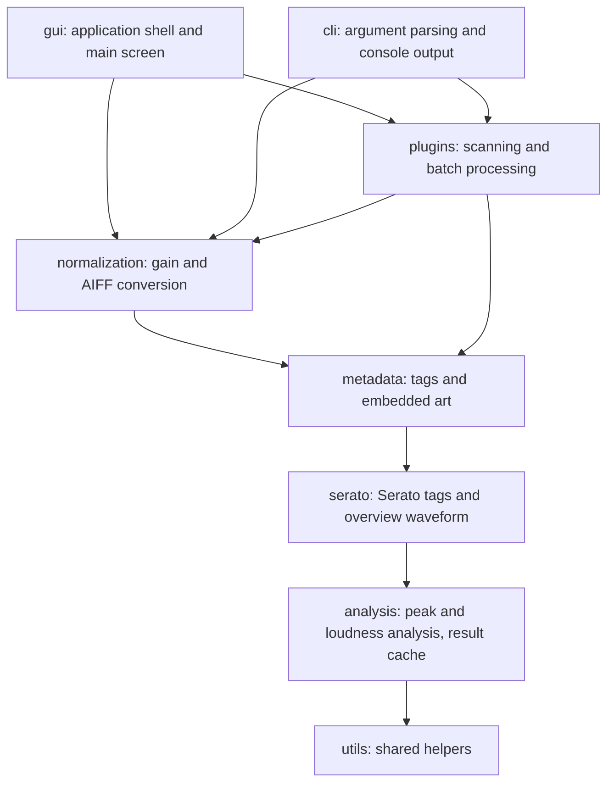
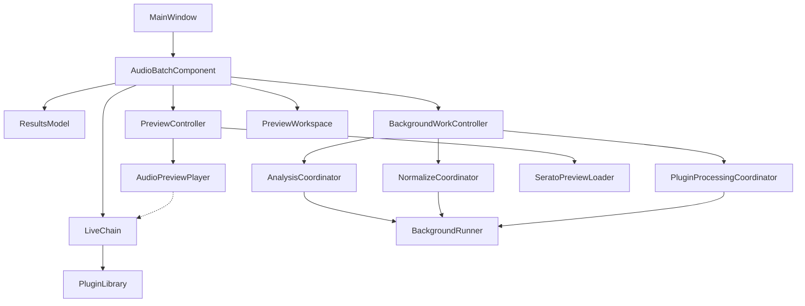

# AudioBatch

GUI and CLI tool (C++23 and JUCE) for analyzing and batch processing audio files.

- Measure sample peak, true peak and integrated loudness (EBU R128).
- Compare files in a sortable results table with live processing status.
- Normalize to a target peak or loudness.
- Batch process through VST3 or Audio Unit effect chains in the GUI.
- Write AIFF output while preserving tags and embedded artwork.
- Cache analysis so unchanged files do not need to be read again.

Supports mono and stereo audio, including WAV, AIFF, FLAC, MP3 and Ogg Vorbis.
Multichannel audio and Linux are not currently supported.

## GUI

Choose a folder or drop folders onto the window to start background analysis.
Use `File > Add Folder...` or hold `Shift` while dropping to add folders without clearing the results.
`Rescan` or `F5` scans all selected folders again, analyzing only new and changed files and keeping the other rows.
`Re-analyze Selected` analyzes the selected files again, ignoring their cached results.
Quit with `Ctrl+Q` on Windows or `Cmd+Q` on macOS.

Sort results by level, loudness or file details, and show or hide columns from the table header menu.
The results context menu lets you normalize, process, re-analyze, reveal or remove selected files.
`File > Normalize All Files...` and `Plugins > Process All Files...` run every analyzed file after a confirmation.
During a run the Process button becomes Cancel, and `File > Cancel Run` (`Cmd+.` or `Ctrl+.`) cancels it too.
Files the run has not committed keep their rows, and `Clear All Files` stops any run.
Removing a row does not delete the file. Moving a file to the trash is a separate action.

### Waveform Preview

View and play tracks with a zoomable waveform.
Playback status and the waveform cursor follow the current display's refresh rate, including high-refresh displays.
The resizable preview workspace has separate columns for controls, selected-file information, and the waveform.
Sample peak, true peak, integrated loudness, and maximum short-term loudness appear in dedicated metric cards.

An optional orange-red short-term loudness line overlays the waveform, with a compact numeric axis on the left.
It measures the trailing three seconds and follows waveform zoom and scrolling.
The initial three seconds use the analyzer's zero-filled startup history.
The curve describes the source file, not custom preview gain, live plugins, or a normalization target.
Silent readings leave gaps, and values outside the selected axis range are clipped.
Analysis retains the existing 10 Hz readings without another decoding pass and caches them in SQLite.
Older cached tracks need one normal reanalysis to populate this history.
After that, unchanged tracks show the curve from the cache.

Serato DJ metadata adds optional waveform colours and coloured cue markers,
and the info panel shows BPM and musical key when available.
Files without Serato tag data show a default blue waveform.
The Up and Down arrow keys navigate the song list even while the waveform has keyboard focus.
Number keys `1` to `8` jump to the corresponding Serato hot cue and start playback from either the song list
or waveform, without clicking or moving keyboard focus first.

Use the small outlined arrow in the controls' top-left corner, or the collapse/expand command in the Options menu.
The shortcut is `Ctrl+Shift+Space` on Windows and `Cmd+Shift+Space` on macOS.
The compact row keeps Play/Stop, Process, all four metrics, and a smaller waveform visible.
Other controls are hidden but retain their settings.

### Live Plugin Preview

Enable **Preview plugin chain** to listen through the enabled effects in chain order.
Plugin editor adjustments affect the preview in real time, and closing an editor does not stop its effect.
The current file's custom input gain is applied before the live chain, including when no plugins are enabled.
Disabling plugin preview returns to unchanged dry playback.
Preview never applies automatic normalization or writes audio files.
The chain runs in stereo, and a plugin that only supports mono gets both channels folded into one,
with its output copied to both.
The output of a mono file is folded back to mono, so it sounds like the processed file.

Each plugin row shows `Latency: X samples (Y ms)`.
The chain window's footer shows the enabled plugins' total latency and the real-time processing sample rate.
Disabled plugins do not contribute to the total.
The footer marks the preparation rate as inspection-only when no audio device is open.
This rate starts at 48 kHz and retains the last playback rate if the device has been closed.
Plugins may report different latency or sound different when batch processing in offline mode.

Latency compensation aligns processed audio with the waveform's file position.
High-latency chains need a preparation pause after starting, seeking, or switching the chain.
The pause primes the effects without permanently delaying dry playback.
Turn **Compensate Preview Plugin Latency** off to hear the plugins' natural uncompensated delay instead.
Changing a latency-affecting plugin setting updates the readouts and may re-prime playback.

At the end of a file, preview drains the delayed final audio and the reported effect tails,
with each plugin's tail limited to 20 seconds.
The position marker stays at the file end while the tail plays.
Stopping, seeking, switching files, or disabling the chain discards the old tail.
Neither live preview nor offline plugin processing applies post-chain anti-clipping gain adjustment.

Offline plugin processing always writes 16-bit PCM AIFF, regardless of the source bit depth.
AudioBatch truncates to 16 bits without adding dither or changing the plugin chain's output gain.
Configure dithering and prevent clipping in the plugins. Samples outside the PCM range saturate on output.
Clipping during the final 16-bit PCM conversion is reported in the processing result and logged as a warning,
without automatic gain reduction.
Floating-point levels above full scale between plugins do not trigger this warning.
Latency compensation and trailing-silence trimming still apply.
Standalone normalization is unchanged.

### Audio Settings

Preview opens the audio output device only when playback starts and never requests recording inputs.
Stopping playback, reaching the end including effect tails, or a playback failure releases the device.
On Windows, switching to another application stops preview and releases the sound card.
Returning to AudioBatch does not automatically resume playback or reopen the device.
The selected interface, sample rate, and buffer size are reused on the next explicit play.
An open Audio Settings window temporarily holds the device for sample-rate, buffer-size, and driver configuration.
Closing that window releases an idle device. Switching applications releases it even while Audio Settings is open.
Playback is output-only on macOS as well and does not require microphone access.

**Audio Settings** separates audio interface/playback configuration from preview preferences.
The preview preferences are also available as ticked commands in the Options menu.
Plugin preview is controlled only from this window and the menu, keeping the main playback controls uncluttered.

- **Preview plugin chain:** off by default.
- **Compensate plugin latency:** on by default.
- **Continue playback when changing files:** off by default.
  When enabled, selecting a different file starts it only if preview was already playing.
- **Play from first cue point:** off by default.
  Newly loaded tracks begin at their earliest cue marker if it is at or before halfway through the track.
  Tracks without an eligible cue begin at zero.
  This also applies when continuing playback across files, but does not start a stopped preview automatically.
  Manual seeks and hot cue jumps take precedence over this initial position.
- **Serato waveform colours:** on by default.
- **Show loudness graph:** off by default.
  Toggle it here or with **Options > Show Loudness Graph**.
  The minimum and maximum axis limits default to **-24 and -4 LUFS**.
  Limits accept integers from -60 to +6 LUFS.

All preview choices and the loudness axis limits are remembered between sessions.
These preferences do not add controls to the main preview workspace.

### Normalization

Select files, choose a mode and target, then normalize from the results context menu.

- **Peak:** -12 to 0 dBFS, default 0 dBFS.
- **Loudness:** -24 to -6 LUFS, default -14 LUFS, with a -0.3 dBTP ceiling to avoid clipping.
  Files may remain below the target when the ceiling limits the gain.

### Plugin Processing

Scan for installed plugins from the plugin menu, then build and configure an effect chain.
Plugins can be reordered, enabled or disabled, and the chain is saved between sessions.
Scanning isolates plugin crashes so they do not take down the app.

The preset row of the chain window saves the chain under a name,
with the plugins, their order, which ones are enabled, and their settings,
and loads or deletes the saved presets.
The Chain Presets submenu of the plugin menu and the Presets submenu of the chain menu list them too,
and Show Presets Folder opens the `Chain Presets` folder next to the settings file,
which holds one XML file per preset.

Processing uses offline rendering, compensates plugin latency and preserves reverb and delay tails.
Output is 16-bit PCM AIFF. Samples beyond full scale saturate and are reported, without gain reduction.
You can normalize before the chain or set a custom input gain for each file.

### Output And Originals

Normalization and plugin processing always write `<name>.aif` next to the source,
keeping its sample rate, tags and artwork.

**These operations replace the original audio.**
Other formats are converted to AIFF and the source is moved to the system trash after a successful write.
Existing `.aif` sources are rewritten in place, with the original moved to the trash first.

- An already existing output file is protected unless `Force overwrite` (GUI) or `--force` (CLI) is enabled.
  Replaced files go to the trash.
- If selected files share an output name, only one is processed. An existing `.aif` source takes priority.
- If metadata cannot be preserved, the file fails and the original is kept.
- On Windows, operations that require trashing a file fail on drives without a recycle bin, such as network shares.

## CLI

Output of `audiobatch --help`:

```text
audiobatch <version> <date> <commit>
Usage: audiobatch [options] <paths...>
       audiobatch list [options]
       audiobatch completion <shell> [options]
       audiobatch help [command] [options]

Commands:
  list                    List the available audio plugins
  completion              Print or install a shell completion script
  help                    Print this message or the help of the given command

Options:
  -h, --help              Print usage and exit
  -V, --version           Print version and exit
  -r, --recurse           Recurse into directories
  -f, --refresh           Ignore cached analysis and re-analyze files
  -n, --normalize         Normalize analyzed files, then report the re-analyzed output peaks
  -F, --force             Let normalize replace an existing output file
      --peak <dBFS>       Normalize to this sample peak, -12 to 0 (default 0)
      --lufs <LUFS>       Normalize to this integrated loudness, -24 to -6, with a -0.3 dBTP ceiling
  -j, --jobs <count>      Override worker count
  -s, --sort <mode>       Sort by peak, lufs, name, or path
  -S, --reverse           Sort in descending order
  -o, --output <format>   Print results as table (default), csv, or json

Run audiobatch help <command> for the options of a command.
```

Without a path, AudioBatch analyzes the current directory.

Analyze a file or scan a library recursively:

```shell
audiobatch "music/song.wav"
audiobatch -r --sort peak "music/library"
```

Normalize to a sample peak or integrated loudness:

```shell
audiobatch -n --peak -1 "music/song.wav"
audiobatch -r -n --lufs -14 "music/album"
```

Normalization follows the same targets and output rules as the GUI.
`-n` without a target defaults to 0 dBFS sample peak.
Results report the levels and paths of the normalized output.

Export analysis as JSON or CSV for scripts and spreadsheets:

```shell
audiobatch -r -o json "music/library" > levels.json
audiobatch -r -s lufs --reverse -o csv "music/library" > levels.csv
```

Default output is a table of peak, true peak, loudness and track name.
Errors, warnings, and progress go to stderr, keeping stdout available for results.
The full log goes to the log file.
Use `--refresh` to bypass cached analysis, including previously failed files.
Short options can be combined, such as `-rf`,
and an option that takes a value takes the rest of the group, such as `-rj4`.

Exit codes: `0` for success, `1` for invalid arguments or output errors,
and `2` when any file fails analysis or normalization.

### Plugin Listing

`audiobatch list` prints the plugins known to the GUI,
and `--rescan` first scans the plugin folders for new or changed ones:

```shell
audiobatch list
audiobatch list -R --group-by type
```

A subcommand is only recognised as the first argument,
so `audiobatch -r list` analyzes a folder named `list`.
Plugin processing itself is GUI-only. CLAP plugins are not supported.

Output of `audiobatch list --help`:

```text
audiobatch <version> <date> <commit>
List the available audio plugins

Usage: audiobatch list [options]

Options:
  -h, --help              Print usage and exit
  -g, --group-by <mode>   Group the plugin list by name (alphabetical), manufacturer, type, or format
  -R, --rescan            Scan for new or changed plugins before listing them
```

### Shell Completions

`audiobatch completion` generates completion scripts for zsh, bash, fish, and PowerShell.
They complete the options, their values, the subcommands, and file paths.
`install.sh` installs them along with the CLI,
and `completions.sh` installs them on their own for the shells of the platform:
zsh on macOS, and bash and PowerShell on Windows.

```shell
# Install the completions for the shells of this platform
./completions.sh

# Print the completion script to stdout
audiobatch completion zsh

# Install the completion script to the shell's completion directory
audiobatch completion zsh --install --verbose
```

Zsh completions go to `~/.zsh/completions`, or into a custom plugin when oh-my-zsh is installed.
Bash completions go to `~/.bash_completion.d`, and fish completions to `~/.config/fish/completions`.
PowerShell completions go to `Documents\PowerShell\completions` on Windows.
`completions.sh` prints what to add to the shell config to load them.
These are the same locations as the Rust `audiobatch-rs` uses.

Output of `audiobatch completion --help`:

```text
audiobatch <version> <date> <commit>
Print or install a shell completion script

Usage: audiobatch completion <shell> [options]

Arguments:
  <shell>                 Shell to generate the script for: zsh, bash, fish, powershell

Options:
  -h, --help              Print usage and exit
  -I, --install           Install the script to the shell's completion directory
  -v, --verbose           Print where the script was installed
```

## Architecture

The GUI and the CLI are two thin front ends over one shared core.
The core reads, analyzes, normalizes and processes audio,
and keeps the results in an SQLite cache so unchanged files are not read again.
Each source directory under `src/` holds one domain, and the domains only depend downwards:



The GUI splits its main screen into a few owners with one job each.
`AudioBatchComponent` wires them together and handles the user actions:



- `ResultsModel` holds the rows of the results table and sorts, merges and removes them.
- `BackgroundWorkController` runs one analysis, normalization or plugin processing pass at a time.
  Each coordinator does its work on a `BackgroundRunner` thread pool,
  and the controller hands the results of the current run back to the message thread.
- `PreviewController` loads the selected file into `AudioPreviewPlayer`,
  and reads its Serato tags, such as the overview waveform and cue points, in the background.
- `PreviewWorkspace` is the bottom section with the file info, the waveform and the preview controls.
- `LiveChain` holds the plugins the preview plays through, and their editors.
  The player only observes it, which the dashed line shows.
  `PluginLibrary` holds the known plugins, and scans for new ones out of process.

## Build

Built with C++23 and JUCE. Requires CMake 4.2 or newer and a supported platform toolchain.
JUCE is included as a submodule.
CMake fetches the other dependencies as needed: SQLite 3, libebur128, TagLib, {fmt} and GoogleTest (tests only).

Run these commands from the `cpp` directory in a terminal on macOS or Git Bash on Windows.

macOS:

```shell
cmake --preset macos-debug
cmake --build --preset macos-debug
```

Windows (Git Bash, with the Visual Studio toolchain):

```shell
cmake --preset windows-debug
cmake --build --preset windows-debug
```

For Ninja with MSVC and a compilation database, use `windows-ninja-debug` instead.

The build produces `AudioBatch.app` / `AudioBatchApp.exe` (GUI) and `audiobatch` (CLI).

For release builds, use the build script:

```shell
./build.sh
```

On macOS, pass `--xcode` to generate and build with Xcode instead of Ninja.
To generate a project and open it in the IDE without building, use `--open`:

```shell
./build.sh --open -b Debug
```

This selects Xcode on macOS and Visual Studio on Windows.
Add `--reuse` to open an existing project without regenerating it.
`--open` cannot be combined with `--ninja`.
With `--open --test`, tests are included in the project but are not built or run.

To install the release build, run:

```shell
./install.sh
```

On Windows, run this from Git Bash.
The GUI app is installed under `%LOCALAPPDATA%\Programs\AudioBatch`,
and a Start Menu shortcut is created for Start search.
The CLI is installed to `~/.local/bin`, together with its shell completions.
Use `--app-only` or `--cli-only` to install just one of the two.
Pass `--reuse` to skip CMake generation and reuse the existing release build directory.

## Development

- `./format.sh` formats C++, CMake and shell scripts. `--check` verifies formatting without changes.
- `./lint.sh` runs clang-tidy. `--check` fails on warnings.
  `--changed` lints only the sources changed since the last commit, and `--staged` only the staged ones.

Build and run tests with the script (Release by default):

```shell
./build.sh --test
./build.sh --test -b Debug
```

The tests build the `AudioBatch Test MS` VST3 in `../test-plugin/` as part of the project,
and check its output against the expected files in `../fixtures/plugin_expected/`.

## TODO

- User config file
