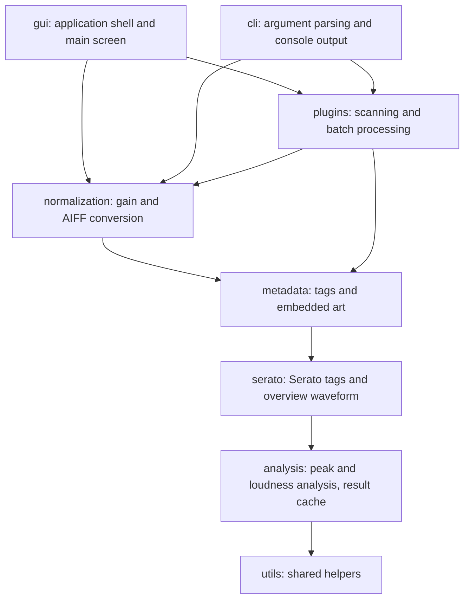
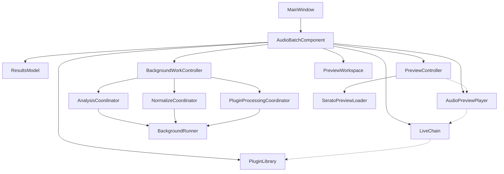

# AudioBatch

GUI and CLI tool (C++23 and JUCE) for analyzing and batch processing audio files.

- Measure sample peak, true peak and integrated loudness (EBU R128).
- Compare files in a sortable results table with live processing status.
- Normalize to a target peak or loudness.
- Batch process through VST3 or Audio Unit effect chains in the GUI.
- Write AIFF output while preserving tags and embedded artwork.
- Cache analysis so unchanged files do not need to be read again.

Supports mono and stereo audio, including WAV, AIFF, FLAC, MP3, Ogg Vorbis and Opus.
On macOS, Core Audio also reads AAC and ALAC.
Windows Media decoding is disabled, so the Windows build does not provide those decoders or WMA support.
Multichannel audio is not currently supported.

## GUI commands

The File menu adds files or folders, selects all files, normalizes the selection, opens parent folders,
and clears per-file gain. The Plugins menu processes the selection through the live chain.
Options offers Output Device and Columns submenus, plus the playback and preview preferences.
Audio Settings uses Cmd/Ctrl+P, Add Folder uses Cmd/Ctrl+Shift+O, and Select All Files uses Cmd/Ctrl+A.
Escape stops playback and returns to the start.

The Folder column, shown beside Name, holds the parent directory.
On macOS a path under a user home starts with `~/`, and other paths stay absolute.
Path is hidden by default and available under Options > Columns.
Sorting by Folder uses the full parent path in natural order, then the file name.

## Source statistics

The inspector's Source lines and six optional table columns, hidden by default, show:

- PLR: whole-file true peak in dBTP minus integrated loudness.
- PSR: whole-file true peak in dBTP minus maximum short-term loudness.
- Crest factor: sample peak over unweighted RMS of all channel samples, including DC, in dB.
- DC: the signed mean of each channel. The column shows the largest absolute mean as percent full scale.
- Clips: samples with magnitude at least 1.0, summed over channels, with per-channel counts in the tooltip.
  Full-scale samples do not prove audible clipping.
- Correlation: the centered Pearson coefficient of the two stereo channels.
  Mono is +1, and a silent or constant stereo channel has no value.

The values describe the source, never custom gain or limiter estimates.
Normalized and processed results describe the quantized output.
Missing values show a dash in the table, `null` in JSON, and an empty field in CSV.
JSON and CSV name them `plrDb`, `psrDb`, `crestFactorDb`, `dcOffsets`, `clipCounts`, `clipsTotal`,
and `stereoCorrelation`, with the channel arrays as JSON arrays in CSV too.

## Processing performance

Normalization and plugin processing measure the exact quantized PCM while writing the final AIFF,
instead of decoding that output again.
Normalization reuses PCM scratch buffers, and an in-place AIFF already at target reuses its current analysis.
Metadata copying, structural output validation, source-identity checks, and cancellation remain in the pipeline.
Plugin processing retains its float intermediate for latency compensation and audible-tail trimming.
The loudness and true-peak meter remains libebur128.

Local Windows x86-64 measurements on October 31, 2026,
compare the pre-change and optimized C++ Release CLIs on the same 26 eligible normalization fixtures.
The existing Rust CLI benchmark harness uses one warmup and ten measured runs at one and 32 workers.
Inputs are copied outside timing, filesystem caches are warm, and builds and tests finish before timing.
The corpus hashes and Rust control binary match between runs.
Normalization timing includes initial source analysis, rendering, output measurement, metadata,
validation, cache updates, and permanent disposal of temporary originals.

Times are mean +/- sample standard deviation in seconds.
Reductions compare the observed C++ means, not a guaranteed speedup.

| Workers | Operation | Before, s | After, s | Mean reduction |
| ---: | :--- | :--- | :--- | ---: |
| 1 | Analysis | 1.216249 +/- 0.026176 | 1.129525 +/- 0.012701 | 7.13% |
| 1 | Peak normalization, 0 dBFS | 2.499244 +/- 0.081625 | 2.399352 +/- 0.166628 | 4.00% |
| 1 | Loudness normalization, -14 LUFS | 2.482048 +/- 0.031524 | 2.386702 +/- 0.036526 | 3.84% |
| 32 | Analysis | 0.344105 +/- 0.004906 | 0.426476 +/- 0.196112 | -23.94% |
| 32 | Peak normalization, 0 dBFS | 0.644645 +/- 0.022174 | 0.627434 +/- 0.092848 | 2.67% |
| 32 | Loudness normalization, -14 LUFS | 0.641227 +/- 0.032131 | 0.678890 +/- 0.145917 | -5.87% |

Negative reductions mean slower observed means.
The measurements are modest and noisy, especially the 32-worker cases.
The optimized analysis maximum is 0.806 seconds and its median is 0.335 seconds,
compared with the original median of 0.343 seconds.
The loudness medians are 0.625 seconds before and 0.616 seconds after, despite its slower optimized mean.
Standalone analysis shifts too, so the table does not isolate the benefit of each change.
The multi-worker results do not establish a reliable overall speedup.
Removing output decoding does not remove its metering, which still accounts for much of the work.
These measurements do not certify macOS performance or plugin-processing throughput.

All measured C++/Rust pairs pass the existing parity checks.
A separate exact C++ before/after comparison passes analysis and normalization at 0/-1 dBFS and -14/-23 LUFS,
with identical output PCM, metadata, and reported levels for all 26 eligible files.
The streaming-meter regressions also compare every loudness-history value and overload flag with output readback.

### TODO: SIMD analysis

Prototype vectorized sample scanning and true-peak interpolation using the Rust optimization work as a guide.
Keep libebur128 as the differential reference and retain a scalar fallback.
Benchmark both individual kernels and whole-file analysis before choosing an implementation.
Verify signed peak ties, overload boundaries, short-term loudness histories, continuous true-peak state,
floating-point rounding, and normalization/plugin output parity across chunk sizes and supported platforms.

Prefer the [C++26 standard SIMD library](https://en.cppreference.com/cpp/numeric/simd) once the supported compiler
and standard-library combinations implement it.
Check `<simd>`, `__cpp_lib_simd`, and a working vector operation rather than just the C++26 language mode.
The draft API has evolved.
The current documentation uses `std::simd::vec<T>` rather than `std::simd<T>`.
Local probes with MSVC 19.51 (STL update 202604) and Clang 23.1.4 using MSVC's STL find neither `<simd>`
nor `__cpp_lib_simd`, even in their latest language modes.
[libc++ 21's status table](https://github.com/llvm/llvm-project/blob/release/21.x/libcxx/docs/Status/Cxx2cPapers.csv)
does not mark the base SIMD proposal implemented,
and the [upstream libc++ implementation tracker](https://github.com/llvm/llvm-project/issues/118384) remains open.
A newer Homebrew Clang alone does not supply missing library features.
Verify the actual libc++ used on macOS, including whether it is Apple's system library or Homebrew's.

If standard-library support is still insufficient,
evaluate [Google Highway](https://github.com/google/highway) for portable x86-64/ARM64 SIMD,
runtime instruction-set dispatch, and scalar fallback within the C++23 baseline.
This is future work: no C++ standard upgrade, meter replacement, or SIMD dependency is introduced here.

## GUI

Open or drop files and folders onto the window to start background analysis.
Add folders without clearing existing results, or rescan to analyze only new and changed files.
Re-analysis ignores cached results.

Sort results by level, loudness or file details, and show or hide columns from the table header menu.
The results context menu lets you normalize, process, re-analyze, reveal or remove selected files.
Batch normalization and plugin processing can run every analyzed file after a confirmation.
Analysis, normalization, and processing runs can be cancelled.
Uncommitted files keep their originals and rows, while completed files show their new output.
Removing a row does not delete the file. Moving a file to the trash is a separate action.

### Waveform Preview

View and play tracks with a zoomable waveform, a Mel-scaled spectrogram, or both in equal side-by-side or stacked panes.
Choose the mode from the preview's context menu, **Options → Preview view**, or **Audio Settings → Preview view**.
The choice persists across sessions. Both panes share the same time interval, zoom, seeking, and cue positions.
Playback continues while either plot is pressed or dragged, without releasing the audio device.
The white line follows actual playback. A dimmer grey line previews the release target while dragging.
Release the pointer to seek once and continue playing, or to start a stopped preview from that position.
The waveform magnitude axis is labeled in dBFS, with 0.0 dBFS at full scale on both polarities.
The status bar shows current and total time as `mm:ss / mm:ss`, alongside file-level background preview progress.
Both times use `h:mm:ss` when the total duration reaches one hour.
Choose a folder with Command/Ctrl+O, or open Audio Settings with Command/Ctrl+P.

The spectrogram shows decoded source power from zero to the file's Nyquist frequency.
Its fixed colour scale does not follow custom gain, plugins, or the playback device's sample rate.
The fixed intensity palette suppresses very quiet signals with a gentle S-shaped display curve.
Fresh analysis builds the complete waveform and spectrogram alongside loudness in one decode pass.
The selected track's waveform fills progressively while analysis runs.
Completed waveform and spectrogram artifacts are cached independently before analysis results are delivered.
Background decoding repairs only missing or outdated artifacts, without invalidating successful loudness analysis.
High-frequency cutoffs can reveal limited bandwidth, but cannot prove whether a file has a lossless encoding history.

Sample peak, true peak, integrated loudness, and maximum short-term loudness appear in dedicated metric cards.
Embedded album artwork appears beside the file name when available.
Artwork can be hidden from the Options menu.

An optional orange-red short-term loudness line overlays the waveform, or the spectrogram in spectrogram-only mode,
with a separate compact numeric axis.
It measures the trailing three seconds and follows preview zoom and scrolling.
Compact outer-edge waveform markers show source sample overloads in yellow and true-peak overloads in orange.
They describe the original audio, not the custom gain or live plugin output.
The **Overload indicators** menu and Audio Settings independently control peak markers, true-peak markers,
and subdued vertical overload lines. Hiding lines preserves the selected edge markers.
Waveform magnitude grid lines appear when the loudness graph is disabled.

Serato DJ metadata adds optional waveform colours and coloured cue markers,
and the info panel shows BPM and the original musical key with its Camelot equivalent when available.
Below the peak and loudness cards, two aligned property rows show bit depth, sample rate, bitrate, duration, and size,
then format, channels, BPM, the original key with Camelot equivalent, and year.
Drag the vertical dividers to adjust the controls and information panel widths within their limits.
Double-click a divider to restore its default width.
Album and comment text wrap within the scrollable details.
Playback supports jumping directly to Serato hot cues.

### Live Plugin Preview

Enable **Preview plugin chain** to listen through the enabled effects in chain order.
Plugin editor adjustments affect the preview in real time, and closing an editor does not stop its effect.
The current file's custom input gain is applied before the live chain, and only while at least one plugin is enabled.
Disabling plugin preview returns to unchanged dry playback.
Preview never applies automatic normalization or writes audio files.
The chain runs in stereo, and a plugin that only supports mono gets both channels folded into one,
with its output copied to both.
The output of a mono file is folded back to mono, so it sounds like the processed file.

The chain window reports plugin latency and the real-time processing sample rate.
Plugins may report different latency or sound different when batch processing in offline mode.

Latency compensation aligns processed audio with the waveform's file position.
High-latency chains need a preparation pause after starting, seeking, or switching the chain.
The pause primes the effects without permanently delaying dry playback.
Turn **Compensate Preview Plugin Latency** off to hear the plugins' natural uncompensated delay instead.
Changing a latency-affecting plugin setting updates the readouts and may re-prime playback.

At the end of a file, preview drains the delayed final audio and the reported effect tails,
with each plugin's tail limited to 20 seconds.
The position marker stays at the file end while the tail plays.
Stopping, seeking, switching files, or disabling the chain discards the old tail.
Neither live preview nor offline plugin processing applies post-chain anti-clipping gain adjustment.

Offline plugin processing always writes 16-bit PCM AIFF, regardless of the source bit depth.
AudioBatch truncates to 16 bits without adding dither or changing the plugin chain's output gain.
Configure dithering and prevent clipping in the plugins. Samples outside the PCM range saturate on output.
Clipping during the final 16-bit PCM conversion is reported in the processing result and logged as a warning,
without automatic gain reduction.
Floating-point levels above full scale between plugins do not trigger this warning.
Latency compensation and trailing-silence trimming still apply.
Standalone normalization is unchanged.

### Audio Settings

Preview opens the audio output device only when playback starts and never requests recording inputs.
An open Audio Settings window temporarily holds the device for sample-rate, buffer-size, and driver configuration.
Windows playback uses ASIO only.
Playback is output-only on macOS as well and does not require microphone access.

**Audio Settings** separates audio interface/playback configuration from preview preferences.
The preview preferences are also available as ticked commands in the Options menu.

- **Preview plugin chain:** off by default.
- **Compensate plugin latency:** on by default.
- **Continue playback when changing files:** off by default.
  When enabled, selecting a different file starts it only if preview was already playing.
- **Play from first cue point:** off by default.
- **Serato waveform colours:** on by default.
- **Show loudness graph:** off by default.
  The minimum and maximum axis limits default to **-24 and -4 LUFS**.
  Limits accept integers from -60 to +6 LUFS.

All preview choices and the loudness axis limits are remembered between sessions.

### Normalization

Select files, choose Peak or Loudness and the target, then press Normalize next to the target,
or normalize from the results context menu.

- **Peak:** -12 to 0 dBFS, default 0 dBFS.
- **Loudness:** -24 to -6 LUFS, default -14 LUFS, with a -0.3 dBTP ceiling to avoid clipping.
  Files may remain below the target when the ceiling limits the gain.

### Plugin Processing

Scan for installed plugins from the plugin menu, then build and configure an effect chain.
Plugins can be reordered, enabled or disabled, and the chain is saved between sessions.
Scanning isolates plugin crashes so they do not take down the app.

The preset row of the chain window saves the chain under a name,
with the plugins, their order, which ones are enabled, and their settings,
and loads or deletes the saved presets.
Presets are stored as XML files in the `Chain Presets` folder next to the settings file.
Changing a loaded chain does not change its preset until it is saved again.

Processing uses offline rendering, compensates plugin latency and preserves reverb and delay tails.
Output is 16-bit PCM AIFF. Samples beyond full scale saturate and are reported, without gain reduction.
You can normalize before the chain or set a custom input gain for each file.

### Output And Originals

Normalization and plugin processing always write `<name>.aif` next to the source,
keeping its sample rate, tags and artwork.

**These operations replace the original audio.**
By default, other formats are converted to AIFF and the source is moved to the system trash after a successful write.
Existing `.aif` sources are rewritten in place, with the original moved to the trash first.
CLI normalization can permanently delete replaced originals instead with `--delete`.

- An already existing output file is protected unless `Force overwrite` (GUI) or `--force` (CLI) is enabled.
  Replaced files go to the trash unless CLI normalization uses `--delete`.
- If selected files share an output name, only one is processed. An existing `.aif` source takes priority.
- If metadata cannot be preserved, the file fails and the original is kept.
- On Windows, operations that require trashing a file fail on drives without a recycle bin, such as network shares.
- Publishing a converted file requires a filesystem that supports hard links.
  Concurrent destination files are not overwritten, and failed recovery retains the audio with its location reported.

## CLI

Ctrl-C cancels the run, removes unfinished temporary output, reports committed files, and exits with code 130.
A second Ctrl-C exits immediately.

Output of `audiobatch --help`:

```text
audiobatch <version> <date> <commit>
Usage: audiobatch [options] <paths...>
       audiobatch process [paths...] [options]
       audiobatch list [options]
       audiobatch completion <shell> [options]
       audiobatch help [command] [options]

Commands:
  process                 Render audio through a saved plugin chain as 16-bit AIFF
  list                    List the available audio plugins
  completion              Print or install a shell completion script
  help                    Print this message or the help of the given command

Options:
  -h, --help              Print usage and exit
  -V, --version           Print version and exit
  -r, --recurse           Recurse into directories
  -f, --refresh           Ignore cached analysis and re-analyze files
  -n, --normalize         Normalize analyzed files, then report the re-analyzed output peaks
  -F, --force             Let normalize replace an existing output file
  -D, --delete            Permanently delete replaced originals instead of moving them to the trash
      --peak <dBFS>       Normalize to this sample peak, -12 to 0 (default 0)
      --lufs <LUFS>       Normalize to this integrated loudness, -24 to -6, with a -0.3 dBTP ceiling
  -j, --jobs <count>      Override worker count
  -s, --sort <mode>       Sort by peak, lufs, name, or path
  -S, --reverse           Sort in descending order
  -o, --output <format>   Print results as table (default), csv, or json

Run audiobatch help <command> for the options of a command.
```

Without a path, AudioBatch analyzes the current directory.

Analyze a file or scan a library recursively:

```shell
audiobatch "music/song.wav"
audiobatch -r --sort peak "music/library"
```

Normalize to a sample peak or integrated loudness:

```shell
audiobatch -n --peak -1 "music/song.wav"
audiobatch -r -n --lufs -14 "music/album"
```

Normalization follows the same targets and output rules as the GUI.
`-n` without a target defaults to 0 dBFS sample peak.
Results report the levels and paths of the normalized output.

`-D` / `--delete` permanently deletes replaced originals instead of moving them to the trash.
For the default analysis command it requires `--normalize`, and it also applies to an existing output replaced with `--force`.
Set `AUDIOBATCH_DELETE=true` to enable it through the environment, or `false` to keep the default trash behavior.
Accepted values are `true`, `1`, `yes`, and `on` to enable it, or `false`, `0`, `no`, and `off` to disable it.
Values are case insensitive, and empty or unrecognized values are rejected.
An explicit `--delete` overrides even an invalid environment value.
The GUI keeps using the trash.

Export analysis as JSON or CSV for scripts and spreadsheets:

```shell
audiobatch -r -o json "music/library" > levels.json
audiobatch -r -s lufs --reverse -o csv "music/library" > levels.csv
```

Default output is a table of peak, true peak, loudness and track name.
Errors, warnings, and progress go to stderr, keeping stdout available for results.
The full log goes to the log file.
Use `--refresh` to bypass cached analysis, including previously failed files.
Short options can be combined, such as `-rf`,
and an option that takes a value takes the rest of the group, such as `-rj4`.

Exit codes: `0` for success, `1` for invalid arguments or output errors,
`2` when any file fails analysis, normalization, or processing, and `130` when interrupted.

### Plugin processing

Save a chain preset in the GUI, then render through it by name or explicit native XML preset path:

```shell
audiobatch process --preset "Master" --recurse --jobs 2 --output json "music/album"
audiobatch process -p "/path/to/Master.xml" -n --lufs -16 --force --delete "music/song.wav"
```

`--preset` / `-p` is required.
A value that is a file, contains a path separator, or ends in `.xml` is a preset file,
and any other value is a preset name in the GUI's `Chain Presets` folder.
Only the C++ XML presets are read, not the Rust JSON presets.
A preset with any damaged slot, enabled flag, or format version is rejected as a whole, before any file is touched.
`--recurse`, `--refresh`, `--jobs`, `--sort`, `--reverse`, and `--output` work as in analysis.
`--normalize` applies a peak or loudness gain before the first enabled plugin, by default a 0 dBFS peak.
A saved custom gain takes precedence, as in the GUI.
`--force` replaces existing outputs, and `--delete` deletes replaced originals instead of moving them to the trash.

The output is a 16-bit sibling `<name>.aif` written by the same processing service as the GUI,
with latency compensation, effect tails, and the source tags and album art.
Ctrl-C keeps committed outputs, removes unfinished ones, and exits with code 130.
A plugin crash or hang can end or block the CLI, since only scanning runs in a separate process.

### Plugin Listing

`audiobatch list` prints the plugins known to the GUI,
and `--rescan` first scans the plugin folders for new or changed ones:

```shell
audiobatch list
audiobatch list -R --group-by type
```

A subcommand is only recognised as the first argument,
so `audiobatch -r list` analyzes a folder named `list`.
CLAP plugins are not supported.

Output of `audiobatch list --help`:

```text
audiobatch <version> <date> <commit>
List the available audio plugins

Usage: audiobatch list [options]

Options:
  -h, --help              Print usage and exit
  -g, --group-by <mode>   Group the plugin list by name (alphabetical), manufacturer, type, or format
  -R, --rescan            Scan for new or changed plugins before listing them
```

### Shell Completions

`audiobatch completion` generates completion scripts for zsh, bash, fish, and PowerShell.
They complete the options, their values, the subcommands, and file paths.
`install.sh` installs them along with the CLI,
and `completions.sh` installs them on their own for the shells of the platform:
zsh on macOS, and bash and PowerShell on Windows.

```shell
# Install the completions for the shells of this platform
./completions.sh

# Print the completion script to stdout
audiobatch completion zsh

# Install the completion script to the shell's completion directory
audiobatch completion zsh --install --verbose
```

Zsh completions go to `~/.zsh/completions`, or into a custom plugin when oh-my-zsh is installed.
Bash completions go to `~/.bash_completion.d`, and fish completions to `~/.config/fish/completions`.
PowerShell completions go to `Documents\PowerShell\completions` on Windows.
`completions.sh` prints what to add to the shell config to load them.
These are the same locations as the Rust `audiobatch-rs` uses.

Output of `audiobatch completion --help`:

```text
audiobatch <version> <date> <commit>
Print or install a shell completion script

Usage: audiobatch completion <shell> [options]

Arguments:
  <shell>                 Shell to generate the script for: zsh, bash, fish, powershell

Options:
  -h, --help              Print usage and exit
  -I, --install           Install the script to the shell's completion directory
  -v, --verbose           Print where the script was installed
```

## Architecture

The GUI and the CLI are two thin front ends over one shared core.
The core reads, analyzes, normalizes and processes audio,
and keeps the results in an SQLite cache so unchanged files are not read again.
[`ARCHITECTURE.md`](ARCHITECTURE.md) explains the parts in more depth, with the threads, the pipelines, and the preview.
Each source directory under `src/` holds one domain, and the domains only depend downwards:



The GUI splits its main screen into a few owners with one job each.
`AudioBatchComponent` wires them together and handles the user actions:



- `ResultsModel` holds the rows of the results table and sorts, merges and removes them.
- `BackgroundWorkController` runs one analysis, normalization or plugin processing pass at a time.
  Each coordinator does its work on a `BackgroundRunner` thread pool,
  and the controller hands the results of the current run back to the message thread.
- `PreviewController` loads the selected file into `AudioPreviewPlayer`,
  and reads its Serato tags, such as the overview waveform and cue points, in the background.
- `PreviewWorkspace` is the bottom section with the file info, the waveform and the preview controls.
- `LiveChain` holds the plugins the preview plays through, and their editors.
  The player only observes it, which the dashed line shows.
  `PluginLibrary` holds the known plugins, and scans for new ones out of process.

## Build

Built with C++23 and JUCE. Requires CMake 4.2 or newer and a supported platform toolchain.
The macOS deployment target is 15.0, and the macOS presets use Clang.
The Windows presets use Visual Studio 18 2026 with x64 output, or Ninja with MSVC or LLVM clang-cl.
GCC is not a supported compiler.
JUCE is included as a submodule.
CMake fetches the other dependencies as needed: SQLite 3, libebur128, TagLib, {fmt} and GoogleTest (tests only).

Run these commands from the `cpp` directory in a terminal on macOS or Git Bash on Windows.

macOS:

```shell
./build.sh --test --debug
```

Windows (Git Bash, with the Visual Studio toolchain):

```shell
./build.sh --test --debug
```

Add `--ninja` on Windows to use MSVC with Ninja and generate a compilation database.

### Windows dependencies

Install [Scoop](https://scoop.sh/) first, then install the available build and development tools through it:

```shell
scoop update
scoop install git cmake llvm uv
```

The Scoop `llvm` package includes `clang-cl`, `lld-link`, `clang-tidy`, and `clang-format`.
Use `scoop install ninja` if your configured buckets provide a Ninja manifest.
If Ninja is not available in Scoop, install it with Winget:

```shell
winget install --exact --id Ninja-build.Ninja
```

Visual Studio is not available in the standard Scoop buckets.
Install Visual Studio Community 2026 and its desktop C++ workload through Winget:

```shell
winget install --exact --id Microsoft.VisualStudio.Community --override "--wait --passive --add Microsoft.VisualStudio.Workload.NativeDesktop --includeRecommended"
```

An existing Visual Studio installation with the x64 MSVC tools and Windows SDK also works.
These are required even when compiling with LLVM, which uses the Microsoft CRT and standard library.
Restart Git Bash after installation so the tools are on `PATH`.

### Windows LLVM builds

Install LLVM and Ninja as described above.
Visual Studio's x64 C++ tools and Windows SDK are still required for the CRT, standard library, and platform headers.
The Clang presets use the MSVC ABI and STL, not MinGW.
They keep separate build directories from MSVC and generate their own compilation databases.
Run from Git Bash:

```shell
./build.sh --clang --test --debug
./lint.sh --clang --check
```

Use `./build.sh --clang --test` for an optimized Release build with checked LLVM LTO and LLD linking.
The script loads the Visual Studio developer environment, configures the workspace, builds, and runs the tests.
Clang's strict source warnings are enabled even though JUCE's clang-cl warning defaults follow MSVC.
The lint script prefers the Clang Debug database when available.
Use `--build-dir cmake-build-windows-ninja-debug` to select the MSVC database explicitly.
`./lint.sh --clang --build-type Release --check` selects the Clang Release workspace.
Other build types, including `RelWithDebInfo` and `MinSizeRel`, use their own directories.
If the selected compilation database is missing, linting first configures and builds that workspace,
including explicit `--build-dir` selections and the macOS `--fuzz` configuration.
Existing explicit directories retain their cached toolchain and build type unless `--build-type` is supplied.
Visual Studio and Xcode generators cannot export compilation databases. Use a separate Ninja directory for linting.
On macOS, `--clang` is accepted by both scripts without changing compiler selection.
The lint script still uses Homebrew `clang-tidy` when available.

### CPU targeting and Release optimization

Windows x64 builds require AVX2 in every configuration, including Debug and sanitizer builds.
There is no fallback for older CPUs.
Local Release builds additionally target the build machine's CPU by default.
On x86 Clang, including Windows clang-cl, this uses `-march=native -mtune=native`,
and on Apple Silicon it uses `-mcpu=native -mtune=native`.
MSVC selects the highest usable, compiler-supported `/arch` level at or above AVX2,
including AVX-512 and AVX10 where available, and applies coarse Intel or AMD `/favor` tuning.
The host probe checks instruction availability and operating-system register state support before selecting a level.
Wider SIMD is not a guarantee of better performance.

`AUDIOBATCH_LTO` defaults to `ON`.
CMake checks C and C++ IPO support before enabling link-time optimization for Release.
The same settings cover the GUI, CLI, tests, and dependencies compiled by this build.
Imported system libraries are unchanged.
Existing Release optimization levels and floating-point semantics are retained.
Sanitizer builds do not enable native targeting or LTO.

CI never uses native CPU targeting, even if `AUDIOBATCH_NATIVE_CPU=ON` is cached or explicitly requested.
It retains the Windows AVX2 minimum and supported Release LTO.
Cross-compilation and macOS universal or non-host architecture builds also disable native targeting.
CMake prints the effective optimization policy when configuring.

The build script selects Release by default:

```shell
./build.sh
```

Add `--clang` for LLVM on Windows, or `--ninja` for Ninja with MSVC.
To disable host-specific targeting while retaining the platform baseline and LTO,
set `AUDIOBATCH_NATIVE_CPU=OFF` in the selected workspace's CMake configuration through your IDE.
Set `AUDIOBATCH_LTO=OFF` there to disable LTO independently.
Options remain in the build directory's CMake cache.
Use the same build script options with `--reuse` to build that configured workspace.
To restore native targeting, set `AUDIOBATCH_NATIVE_CPU=ON` again.
Native options and LTO only apply to the Release configuration, including in Visual Studio and Xcode projects.
Do a clean rebuild after moving a native build directory to another CPU.
Native binaries may not run on machines with fewer instruction extensions.
A Windows baseline binary still requires AVX2.

### Local macOS signing

The `AudioBatchSign` target signs the finished `AudioBatch.app` after every resource copy, with Ninja and Xcode alike,
using `sign_mac_app_bundle` from the root `common.sh`, shared with the Rust build.
Xcode automatic signing is disabled.
`CODESIGN_IDENTITY` selects an installed identity, and an unset or empty value signs ad hoc.
An invalid identity fails the build.
Building only `--target AudioBatch` skips signing, so build `AudioBatchSign` too.
The signature uses the hardened runtime,
and the shared [`macos.entitlements`](../assets/macos.entitlements) only disables library validation,
so third-party plugins load. The signature is for local use, without notarization.

```shell
codesign --verify --deep --strict --verbose=2 cmake-build-mac-debug/AudioBatch_artefacts/Debug/AudioBatch.app
uv run --script ../tests/test_mac_signing.py
```

`AUDIOBATCH_TEST_NATIVE_SIGNING=1` makes the test also sign and inspect real bundles on macOS.

### Build script and installation

The build produces `AudioBatch.app` or `AudioBatch.exe` (GUI) and `audiobatch` (CLI).
`build.sh` copies them into this directory, where the Windows GUI becomes `AudioBatchApp.exe`.

For release builds, use the build script:

```shell
./build.sh
```

Add `-d` or `--debug` for a Debug build.
The existing `-b` or `--build-type` option remains available for Debug and other configurations.
If both options are supplied, the last build-type selection wins.

On macOS, the script builds with Ninja, or with Xcode when given `--xcode`.
On Windows, it builds with Visual Studio, or with Ninja and MSVC when given `--ninja`.
Use `./build.sh --clang` for Ninja with LLVM clang-cl and LLD.
For Ninja, the script loads the Visual Studio x64 developer environment when `cl` is not already on PATH,
so it can run from plain Git Bash.
`-l` or `--cli-only` builds only the CLI.
Pass `-c` or `--clean` to delete the selected CMake build directory and its local compilation cache before configuring.
Only the directory for the selected generator and build type is removed.
Other build directories are kept.
`--clean` cannot be combined with `--reuse`.
To generate a project and open it in the IDE without building, use `--open`:

```shell
./build.sh --open --debug
```

This selects Xcode on macOS and Visual Studio on Windows.
Add `--reuse` to open an existing project without regenerating it.
`--open` cannot be combined with `--ninja`.
With `--open --test`, tests are included in the project but are not built or run.

To install the release build, run:

```shell
./install.sh
```

On Windows, run this from Git Bash.
The GUI app is installed under `%LOCALAPPDATA%\Programs\AudioBatch`,
and a Start Menu shortcut is created for Start search.
The CLI is installed to `~/.local/bin`, together with its shell completions.
Use `--app-only` or `--cli-only` (`-l`) to install just one of the two.
Pass `--reuse` to skip CMake generation and reuse the existing release build directory.
Pass `-c` or `--clean` to remove that directory and its local compilation cache before rebuilding and installing.
For example, `./install.sh --clean` starts with a fresh release CMake configuration.

## Development

### Profiling tools

Install [samply](https://github.com/mstange/samply) through Cargo for sampling profiles of release builds:

```shell
cargo install --locked samply
```

Cargo is needed to install this optional development tool, not to build or run the C++ application.
See [Analysis performance](../docs/performance.md#reproducing-the-measurements) for shared benchmark
and profiling setup.

### Formatting and verification

The plugin-linked test executable also has a standalone `--vst3-benchmark` mode.
It does not run unit tests or change the application CLIs.
Run the shared [VST3 benchmark runner](../rust/scripts/vst3_benchmark.sh) from `../rust`:

```shell
./scripts/vst3_benchmark.sh
```

The runner uses the same real AudioBatch Test MS bundle in both hosts,
measures already decoded audio with preallocated buffers, and verifies every sample outside timing.
Host mode includes a single host and input/output transfers.
Chain mode adds the production channel adapter and finite checks.
State restoration, loading, decoding, and sample exports are excluded from both timing boundaries.

- `./format.sh` formats C++, CMake and shell scripts. `--check` verifies formatting without changes.
- `./lint.sh` runs clang-tidy. `--check` fails on warnings.
  Every run reports warning and error totals, counting repeated header findings only once.
  `--changed` lints only the sources changed since the last commit, and `--staged` only the staged ones.
  `--prepare` refreshes a Ninja workspace's compile database and generated headers without compiling the applications.
  CI uses `./lint.sh --prepare --build-type Debug --check` for the same lightweight setup locally and on runners.

Use the test script to configure, build, and run the Debug tests without packaging the applications:

```shell
./test.sh
```

It shares the default platform build directory and compilation cache with `build.sh`.
CTest runs each JUCE unit test suite as its own test, with a time limit per suite.
The default run also builds and runs the executable CLI contracts and nonvisual GUI integration tier.
The CLI contracts require uv.
Use `--unit` or `--integration` to build and run only that tier.

CI compiles all test targets first, then runs each tier separately with its own timeout:

```shell
./test.sh --build-type Debug --build-only
./test.sh --build-type Debug --unit --no-build
./test.sh --build-type Debug --integration --no-build
```

For Release tests, use `./test.sh --build-type Release`.
Select an existing Ninja, Xcode, or Visual Studio workspace with `--build-dir` and its `--build-type`.
For example, `./test.sh --build-dir cmake-build-windows-clang-debug` uses the Windows LLVM workspace.
`./build.sh --test --debug` still builds and packages the applications, then invokes the same test runner.
On Windows, add `--ninja` to `build.sh` for MSVC with Ninja, or `--clang` for LLVM.

The tests build the `AudioBatch Test MS` VST3 in `../test-plugin/` as part of the project,
and check its output against the expected files in `../fixtures/plugin_expected/`.

`./sanitize.sh` builds and runs the tests under AddressSanitizer and UndefinedBehaviorSanitizer with `macos-asan`,
or under MSVC AddressSanitizer only with `windows-asan`.
`./sanitize.sh --clang` uses LLVM AddressSanitizer with `windows-clang-asan` on Windows.
That preset uses RelWithDebInfo because LLVM AddressSanitizer does not support the Debug CRT.
It retains debug symbols and standard library hardening, without native targeting or LTO.
`./sanitize.sh --thread` runs them under ThreadSanitizer on macOS.
Each sanitizer build has its own build directory, so the debug build is not affected.

The libFuzzer harnesses in `tests/fuzz/` need the Homebrew LLVM, since Apple Clang does not ship libFuzzer.
`./lint.sh --fuzz` configures and builds the harnesses when their compilation database is missing,
then lints them with that workspace's flags.
Use the fuzz script to build both harnesses, replay the committed corpus, and fuzz each harness for a minute:

```shell
./fuzz.sh
```

CI uses the same script with `--build-only`, then `--no-build --replay`, then `--no-build --fuzz --seconds 60`.
`./lint.sh --fuzz --check` lints the built harnesses.
New fuzz inputs stay in `fuzz-scratch/`, and crashing inputs go to `fuzz-artifacts/` without changing the committed corpus.
