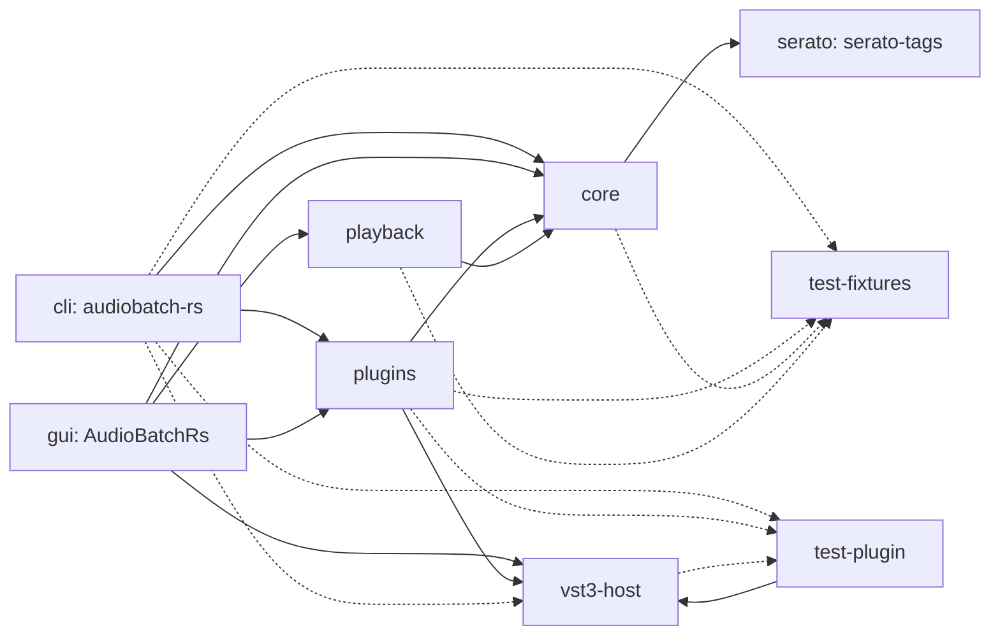
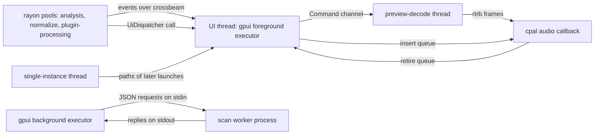
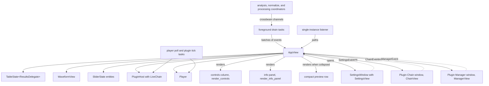
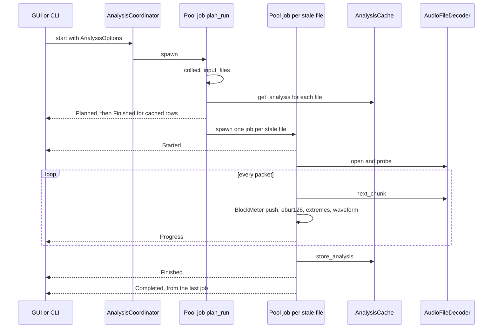
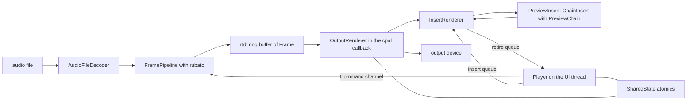

# Architecture

This document describes how the Rust version of AudioBatch is put together, for a developer new to the code.
AudioBatch analyzes audio files for sample peak, true peak, and EBU R128 loudness, and draws a waveform overview.
It normalizes files to a peak or loudness target as AIFF,
processes them through a chain of VST3 effects, and previews them through the live plugins.
`README.md` describes what the tools do, and `AGENTS.md` lists the rules for changing them.

## Crates

Solid arrows are normal dependencies, and dotted arrows are dependencies of the tests only.

- `core` decodes, analyzes, caches, and normalizes files, and sets up the log file of both binaries.
- `serato` parses the Serato `GEOB` tags from raw frame bytes, and computes the colours of the Overview tag.
- `playback` is the preview engine: a decode thread, a ring buffer, and the `cpal` output callback.
- `vst3-host` wraps the raw `vst3` bindings in a safe interface,
  and its `editor` feature adds the native editor windows.
- `plugins` builds scanning, the saved chain and presets, offline processing, and the preview chain in safe code.
- `cli` and `gui` are the front ends, and only `gui` depends on gpui-kit.
- `test-plugin` serves fake VST3 plugins to the tests,
  and `test-fixtures` locates the shared fixtures in `../fixtures` and the JUCE test plugin.

`core` and `playback` have no GUI dependency, so the GUI framework can be replaced without touching them.
They have no plugin code either.
The preview engine knows plugins only through the `PreviewInsert` trait,
which the GUI implements with `ChainInsert`, a wrapper of the `PreviewChain` from `plugins`.
The workspace lints deny unsafe code, and only `vst3-host` and `test-plugin` allow it, module by module.

## Threads

**The UI thread.**
VST3 requires module loading and the whole instance lifecycle to run on the thread of the event loop.
Only `process` and `setProcessing` may run elsewhere.
`UiThread` is a token that proves the current thread is that thread.
`UiThread::register_current` creates it, and it is neither `Send` nor `Sync`,
so a method that takes `&UiThread` can only be called there.
The GUI registers its main thread in `start_plugin_jobs` before the main window opens,
and tests start a dedicated `vst3-ui` thread with `UiThread::spawn_dedicated`.

**`UiDispatcher` and `UiJobs`.**
`ui_channel` in `vst3-host/src/thread.rs` connects the two.
`UiDispatcher::post` queues a job, and `UiDispatcher::call` waits for its result.
While it waits, `call` polls the caller's cancellation check and abandons a job that has not started,
so the UI thread can cancel a run and wait for its workers without a deadlock.
The GUI runs the jobs from a foreground task, one by one as `UiJobs::recv` returns them.
`UiBound` holds a value that any thread may own but only the UI thread may reach or drop,
which is how a processing worker owns its plugin instances.

**The worker pools.**
`AnalysisCoordinator`, `NormalizeCoordinator`, and `ProcessingCoordinator` each own a rayon pool.
The GUI gives analysis and normalization one worker per CPU,
and processing one less than the physical cores, from `default_worker_count`.
`start` returns a run id and a crossbeam `Receiver` of the run's events.
A new run or `cancel` bumps the current run id, and jobs of an older run stop early and publish nothing more.
The exception is a file whose output was already committed, which is still reported, because its source was replaced.
Each job catches a panic, so a decoder or plugin that panics fails only its file.

**Playback and other threads.**
`Player::with_config` starts the `preview-decode` thread, which runs `run_decode_thread` in `playback/src/engine.rs`.
`cpal` calls the output callback on a thread of the audio host, see [Preview](#preview).
A `single-instance` thread listens for later launches of the GUI.

**The scan worker.**
`scan_plugins` never loads plugin code itself.
It starts the running executable again with `WORKER_FLAG`,
and both `main` functions check that flag first and call `run_scan_worker`.
The worker makes its main thread the UI thread and pumps the platform event loop while it waits,
because copy-protected plugins post licensing work to the main run loop.
One worker serves a whole scan, and it is started again after a crash or a timeout.

**Logging.**
`log_file::install` in `core/src/log_file.rs` installs a `tracing` subscriber that writes the log file,
prints to stderr up to a chosen level, and forwards the records of crates that use the `log` facade.
`analyze_file`, `normalize_file`, and `process_file` each enter a span with the file path,
so a message from a worker thread names its file.
Tag reads and metadata copies also enter file spans.
Each decoder retains its file span and enters it while opening, decoding, and seeking,
so preview warnings keep their file context even without an analysis span.
Log file lines include the source module, including third-party crates.
Levels are right-aligned as ` [INFO]:`, ` [WARN]:`, and `[ERROR]:`, so message columns line up.
Warnings and errors also include the source file and line when available,
even when a framework error has an empty module target.
The formatter shortens compile-time source locations to their crate and source-relative path,
without absolute build-machine directories, while retaining full audio file paths in the operation spans.
The CLI logs what it already printed with the `FILE_ONLY_TARGET` target, so it is not printed twice.
The GUI logs opened input paths, discovered file counts, and analysis duration and result counts at the info level,
without requiring `AUDIOBATCH_GUI_DEBUG`.
Nothing logs from the audio callback.

## Errors and reporting

The library crates use domain-specific error types derived with `thiserror`.
Their variants distinguish failures without parsing messages and retain concrete underlying causes,
such as I/O, decoder, database, or plugin host errors.
Existing standard error types remain in use where they already describe the operation.
The analysis classification in `AnalysisError` still determines which failed records the cache can retain.
VST3 processing and dispatcher errors stay lightweight,
and error handling does not allocate or log inside the audio callback.

The CLI and GUI use `anyhow` to combine library failures with application context.
They render messages at their reporting boundaries, while `tracing` writes the logs.
Analysis records, operation outcomes, recovery warnings, and scan worker replies retain their text fields,
so errors become strings when those records or protocol messages are constructed.
Typed errors preserve their sources until that boundary.
User-facing messages and the serialized formats do not depend on the internal error representation.

## GUI structure

On Windows, the main window's native close request quits through GPUI without letting Win32 destroy the handle first.
GPUI then owns native resource teardown, so application shutdown does not destroy the same window twice.
Auxiliary windows use GPUI's normal close path.
Any framework teardown errors remain visible in the log.

`AppView` in `gui/src/app/` is the root view of the main window.
`mod.rs` holds its state, and each other module adds one concern in an `impl AppView` block:
`startup.rs` opens the cache, the coordinators, the player, and the plugin host,
`analysis.rs`, `normalize.rs`, and `process.rs` the runs, `selection.rs` the selection, `gain.rs` the per-file gain,
`actions.rs` the menu and transport actions, `plugins.rs` the chain and its windows, `preview.rs` the live preview,
`preferences.rs` the settings, `tags.rs` the tags of the selected file, `artwork.rs` its album artwork,
and `render.rs` the layout.

`AppView` owns three kinds of gpui entities:
the results table, a `TableState<ResultsDelegate>` that renders only the visible rows,
the `WaveformView`, and the four `SliderState` sliders.
The controls column and the information panel are not entities.
`render_controls` and `render_info_panel` draw them from the view's state on every render,
and the controls send a `ControlsEvent` back through a listener.
`preview_widths` switches both to their wide layouts once half of the preview is wide enough for them to share,
and leaves the other half to the waveform.
The preview collapses into one row through the chevron, the Options menu, or the `TogglePreviewSection` shortcut.
`render_compact_preview` then shows the chevron, Play and Process, the four metrics, and the waveform,
and the `ResizableState` keeps the divider where it was for when the preview expands again.
The expanded preview starts at the height that fits its controls, from `fit_height` in `controls.rs`,
after startup geometry settles, including deferred platform maximization.
The initial split is committed once and is not refitted on later window resizing or artwork arrival.
The divider state survives selection changes and collapse/expand.

The information panel shows the embedded album artwork of the selected file beside its name,
unless the Show Album Artwork option is off.
`app/artwork.rs` reads it on a background task, separate from the tag read,
so a slow picture never delays the cue points or the Serato colours.
`read_artwork` in `core/src/tags.rs` uses Lofty without audio properties,
then retains one picture of up to 16 MiB, preferring the front cover and otherwise the first available picture.
`gui/src/artwork.rs` checks its header before decoding,
skipping anything that is not a PNG or a JPEG of at most 4096 pixels on either side.
The selected picture becomes a BGRA thumbnail of at most 96 pixels, drawn at 48.
A result is shown only while its generation and file identity still match the selection.
Only one artwork read runs at a time, with the latest pending identity replacing intermediate requests.
Generation and identity checks run before parsing, before decoding, and at foreground adoption.
Completed no-art identities are remembered until selection, source identity, or a forced refresh changes them.

The Audio Settings, Plugin Chain, and Plugin Manager windows are gpui windows,
held in `SettingsWindow` and `PluginWindow`.
Each shows a snapshot of the state `AppView` owns and sends what the user does back as an event,
and `AppView` applies it and shows the window a new snapshot.
Plugin editors are native windows of `vst3-host` instead, see [VST3 hosting](#vst3-hosting).

Work that waits runs as `cx.spawn` tasks on the foreground executor, which is the main thread.
Each run gets a drain task that owns the run's crossbeam receiver.
Every 50 milliseconds it takes the waiting events with `try_recv`,
and applies the batch in one update of the view, filtered by run id,
so a large run updates the table at a steady rate instead of once per event.
It ends when the channel disconnects after the run's last job, or when the view is gone.
The player poll task reads `Player::poll_events` and calls `close_idle_stream` every 100 milliseconds.
The plugin tick task prepares instances again after a rate change or a restart request,
keeps the preview chain in step, saves the settings of closed editors, and shows the scan progress.
Blocking reads, such as the tags of the selected file and plugin scans, run on the gpui background executor.

Only one app runs at a time.
`single_instance::claim` finds a running app through a port file in the data directory and a loopback socket,
and hands it the paths when it answers with its greeting.
The port file is readable only by the user and holds a random token that a launch must send before its paths,
and a lock file makes launches that start at the same time decide one after the other.
Otherwise this launch becomes the running app,
and `listen_for_launches` opens the paths of later launches as if they were dropped onto the window.

## Analysis

`analyze_file` decodes a file once, and every decoded block feeds all the measurements.

**Decoding.**
`AudioFileDecoder` in `core/src/decode.rs` probes the file with symphonia
and returns planar `f32` chunks of the default audio track from `next_chunk`.
It trims encoder delay and padding the way the decoders of the C++ application do,
so both applications measure and write the same samples.
Symphonia trims MP3 files with a LAME header itself,
and for other MP3 files the decoder leaves out the 529 samples of synthesis delay.
`decode/gapless.rs` reads the MP4 edit list or `iTunSMPB` atom, which symphonia parses but never applies.
`DecodeFailureTracker` turns an isolated failed packet into silence and a notice,
while three failures in a row stop the pass, so no pass works on truncated audio.

**Measurements.**
`BlockMeter` regroups the chunks into blocks of a tenth of a second, one per short-term loudness point.
Complete aligned blocks borrow decoder planes, while incomplete or silence-padded blocks reuse sample buffers.
Plane references use fixed storage for the meter's maximum 64 channels.
Each block goes into an `ebur128` meter with integrated and short-term modes,
into the true peak meter, the per-channel sample extremes, the `WaveformBuilder`, and source overload history.
A mono file is measured as dual mono, so it reads the same loudness as the same content in stereo.

`loudness/true_peak.rs` measures true peak on every architecture with `fearless_simd`.
Below 96 kHz its four interpolation phases occupy separate `f32x4` lanes,
and from 96 kHz to below 192 kHz the two phases are duplicated into those lanes.
At 192 kHz and above `BlockMeter` reuses the signed sample extremes instead of scanning samples again.
The coefficients, tap order, separate multiply and add, and undrained history match ebur128.
Ordered comparisons ignore NaNs without relying on backend-specific SIMD maximum semantics.
Hardware dispatch detects NEON on Apple Silicon or AVX2 on x86 once per process.
AVX-512 capable AMD CPUs also use the AVX2 backend, with no SSE compatibility paths.
Tests compare the selected hardware backend and a forced scalar fallback with the reference.
The same SIMD path runs on x86 without an opt-in or reference fallback.
The safe SIMD kernel leaves the caller's floating point environment unchanged.
Ebur128 temporarily enables flush to zero on x86 with SSE2,
and a focused x86 test demonstrates different arithmetic-underflow results.
Windows execution and timings remain a separate validation pass.

Integrated and short-term loudness keep the reference's sample summation order.
A rolling sum of block energies would change the exact short-term history, maximum, and cache blobs,
so it cannot replace the reference under the frozen golden contract.
The benchmark commands, profiling breakdown, and validation limits are in [Analysis performance](docs/performance.md).

`WaveformBuilder` merges neighbouring buckets whenever their count passes 8192,
and `WaveformOverview` keeps them quantized to 8 bits with coarser levels for drawing.
The Serato Overview tag only colours the waveform, while its shape comes from the decoded audio.

`overload.rs` records independent sample-over and true-peak-over bits for each actual source channel.
Sample flags come from block-local decoded extrema, while true peak uses the last nonempty push's maxima,
including interpolation history without resetting the cumulative peaks or flushing an EOF tail.
Exactly full scale is not an overload.
Adjacent flag buckets merge with bitwise OR when their count would exceed 8192,
and future blocks accumulate at the increased stride.
The history retains rate, decoded length, channel count, and a validated power-of-two block stride.
A present all-clear history is distinct from missing analysis.
These source measurements remain independent of preview gain and plugins.
The waveform attaches history only when the record, waveform timing, and on-disk identity agree.
Sample overs use solid amber edge caps and a restrained channel tint, while true-peak-only overs use hollow caps.
Projection merges flags per screen column so isolated subpixel warnings stay visible,
and extends true peak coverage conservatively across interpolation boundaries without shifting sample regions.

**The cache.**
`AnalysisCache` in `core/src/cache.rs` keeps one SQLite row per path,
with the levels, loudness history, waveform and overload history as independent blobs, and the user's custom gain.
Successful rows require valid overload history matching their decoded stream.
Older rows or missing or malformed history trigger reanalysis through an additive migration and analysis version gate.
A refill retains same-identity custom gains, including explicit clears, and leaves Serato rows untouched.
A row holds while the file keeps the stored size and modification time and the analysis version is current.
Failures that would repeat for the same bytes are stored too, so a broken file is not decoded again.
The connection opens lazily behind a mutex, so every worker can use the cache.
`cache/serato.rs` adds the `serato_tag_cache` table with the schema of the C++ application's table.
The database lives in the `AudioBatch-rs` data directory, apart from the C++ application's cache.

## Normalization and processing

Normalization in `core/src/normalize.rs` and processing in `plugins/src/processing.rs` both write `<name>.aif`.
They write it next to the source, commit it, and analyze the result.
Both require a finished analysis, and analyze the source again first when it changed on disk.
Lossless sources normalize to the same samples as in the C++ application, which `scripts/compare_outputs.py` checks.

**The gain.**
In peak mode, `normalization_gain` brings the sample peak to the target.
In loudness mode it brings the integrated loudness to the target, limited by the -0.3 dBTP true peak ceiling.
A silent file, or one that would need more than 40 dB, is refused rather than capped.
Processing applies the file's custom gain before the first plugin,
or else the normalization gain when the Normalize option is on.
A file the normalization refuses is processed at unity gain, with a notice that says why.

**Normalization** streams the decoded chunks, scaled by the gain, into an `AiffWriter` without dither,
keeping the source bit depth when AIFF supports it.

**Processing** accepts mono and stereo sources.
The worker's `ProcessingChain` asks the UI thread to prepare every plugin for the file:
restore its saved settings, configure the main buses for the file's channels,
set up offline processing in blocks of `PROCESSING_BLOCK_FRAMES`, and activate it.
`ChainSignal` passes every block through the chain's `ProcessorHandle`s.
It copies a mono signal to both channels of a stereo input and folds a stereo signal to the average for a mono input,
so the order of the plugins never drops a channel.
After the source, `render_blocks` renders the plugins' latencies and tails, each tail at most 20 seconds,
and drops the first latency frames, so the output lines up with the source.
The `f32` render goes to an anonymous temporary file.
Trailing audio below -96 dBFS is trimmed, but the output is never shorter than the source.
`write_final_output` floors the samples to 16 bits without dither or gain changes,
and reports samples beyond full scale, which saturate.
Both test suites check processing against the expected outputs of the JUCE test plugin.

**Committing.**
`AiffWriter` in `core/src/aiff.rs` writes 16 or 24-bit PCM and patches the header sizes in `finish`.
Normalization raises source depths below 16 bits to 16-bit output.
It converts floats the way JUCE does, so both applications write the same sample values.
Both operations render into a hidden temporary file from `create_temporary_output` in the destination folder,
copy the tags and Serato data onto it with `copy_metadata`, and check it with `validate_written_audio`.
`commit_temporary_output` in `core/src/output_file.rs` then moves an existing output aside to a hidden backup,
syncs and renames the new file into place, and disposes of a converted source.
A failed step puts the backup back, so the folder is left as it was, and the backup is disposed of last.
An `.aif` source rewritten in place has a copy of it disposed of first,
through the `FileDisposer`, which moves files to the system trash by default.
Cancellation is checked once more before the original is touched.

**Runs.**
`NormalizeCoordinator` and `ProcessingCoordinator` run one pool job per file.
`find_batch_output_conflicts` fails all but one of the sources that would write the same output,
and `update_cache` removes a converted source from the cache and stores the analysis of its output.
A processing run gets one `ProcessingChain` per worker, created on the UI thread before the run starts,
and each job leases a free one, so a chain is only ever used by one worker at a time.

**`ProcessorHandle`.**
`PluginInstance::processor` returns a handle that owns a buffer for every channel of every bus,
sized for the largest block, together with the parameter change objects and the process context.
The caller fills the main inputs, calls `process`, and reads the main outputs.
Auxiliary inputs get silence, and edits from the controller are delivered at the start of each block.
Nothing in `process` allocates or locks, so the same handle runs offline and in the audio callback.
A guard keeps two handles of one instance from processing at once, which VST3 forbids.

## Preview

`Player` in `playback/src/lib.rs` stays on the thread that created it, the UI thread in the GUI,
because the cpal stream is not `Send` on every platform.
Windows uses CPAL's ASIO host, and other platforms use their default host.
ASIO device metadata is cached on the player thread before streaming,
because enumerating another driver while a stream is open can interrupt discovery.
The ASIO driver owns the callback thread and its scheduling, which CPAL's `realtime` feature does not change.
On the decode thread, `FramePipeline` decodes the file, copies mono to both channels,
resamples with `rubato` when the file rate differs from the device rate,
and tags every stereo `Frame` with the playback generation and its source position.
The ring buffer holds half a second of output.
Every load and seek starts a new generation, and the callback drops the frames of older ones,
so a seek takes effect at once, and the playhead is the position of the last played frame.
The preview refuses files with more than two channels.
The output stream opens on play, and `close_idle_stream` closes it 300 milliseconds after playback stops,
so other applications can use the device.

**Inserts.**
`PreviewInsert` is an effect on the stereo output inside the callback.
`Player::set_insert` sends a boxed insert over a lock-free `rtrb` queue, and the callback swaps it in at its next block.
The insert it replaces goes back over the retire queue,
and the UI thread drops it after `take_retired_inserts` on its next plugin tick.
The callback swaps only while the retire queue has room, so it never drops an insert itself.
`InsertRenderer` in `playback/src/output/insert.rs` applies the file's custom gain only in front of the insert.
It resets the insert on every start, seek, resume, and change,
and pre-rolls its latency in silence when latency compensation is on.
It fades in and out over 64 frames,
and at the end of the file it feeds silence for the latency and the tail while the playhead waits.
Output that is not finite stops playback.

**`PreviewChain`** is built on the UI thread from the live instances of `LiveChain`,
which `prepare_for_preview` prepared for stereo realtime processing at the output rate.
A plugin that refuses stereo is prepared for mono, and `ChainSignal` folds the signal into it.
For a mono file, `InsertRenderer` folds the output back to mono, so the preview sounds like the processed file.
A plugin whose `process` call fails is recorded in the chain's `PreviewFailure`, and the chain goes silent.
The UI thread then formats the message and turns the preview off, because formatting allocates.
Before instances are prepared again, `detach_plugin_preview` removes the chain and waits for the callback to let go.

**Realtime rules.**
The callback, every `PreviewInsert`, and `PreviewChain` must not allocate, lock, block, or wait for I/O.
Their blocks are allocated up front, and state crosses threads through atomics and the `rtrb` queues.
The renderer sits behind a mutex only so the player can apply insert changes while no stream runs.
The callback calls `try_lock` and outputs silence in the rare case it misses the lock.
Stream errors go unformatted through a bounded channel and are formatted on the UI thread.

## VST3 hosting

**Lifecycle.**
`Module::load` loads a bundle and gets its plugin factory, through `CFBundle` on macOS.
Modules stay loaded for the life of the process, because unloading some plugins mid-session crashes them.
`factory.rs` lists the classes as `ClassInfo`, identified by `ClassId`.
`PluginInstance::create` initializes the component, finds or creates its edit controller,
connects the two, and copies the component state into the controller.
`configure_main_buses`, `setup` with a `ProcessMode`, and `activate` prepare it,
and `processor` returns a `ProcessorHandle`.
While a handle exists, calls that change the setup are refused.
State moves in and out as a `PluginState` with the component and controller blobs.
Dropping the last reference tears the plugin down on the UI thread, posting the teardown there if needed.

**Host objects.**
`host_objects/` implements the COM objects the host gives to plugins.
`HostApplication` is the context plugins are initialized with, and creates messages and attribute lists.
`MemoryStream` carries state, `ComponentHandler` queues the controller's edits and collects restart requests,
and `ParameterChanges` delivers values to `process`.
None of them lock or allocate in the calls a plugin makes from its processing thread.

**Editors.**
`EditorWindow` in `editor/` shows an editor in an `NSWindow` on macOS or a Win32 window on Windows,
because gpui draws its Windows content on top of child windows, which would hide the plugin's window.
`PlugFrame` receives the editor's resize requests.
Closing the window only hides it, so `LiveChain` captures the settings on the next tick before destroying it.

**Unsafe code.**
Each module of `vst3-host` that needs unsafe code opts in with `#![expect(unsafe_code, reason = "...")]`,
and every unsafe block has a `// SAFETY:` comment, which the `undocumented_unsafe_blocks` lint enforces.
COM pointers never leave `vst3-host`, so `plugins` and the front ends stay safe.
The `vst3` crate is pinned to `=0.3.0`, whose bindings come from VST SDK 3.8.0, the SDK that JUCE bundles.

**Scanning.**
`scan_plugins` in `plugins/src/scanner.rs` runs while its caller holds the cross-process `ScanLock`.
It skips unchanged and blacklisted bundles, and describes a bundle from its `moduleinfo.json` when it has one.
Other bundles go to the worker as JSON lines on stdin,
and replies come back on stdout behind a marker, because plugins print to stdout too.
A crash blacklists the bundle, and one that takes longer than `SCAN_TIMEOUT` is skipped.
The result goes to `plugins.json`, which the CLI and the GUI share.

## Differences from the C++ version

The C++ application in `../cpp` is the reference implementation.
The Rust version differs from it on purpose in these points:

- It hosts VST3 plugins only, on macOS and Windows, and no Audio Units.
- It keeps its cache, logs, plugin list, chain, and presets in its own `AudioBatch-rs` folders,
  with the plugin data as JSON, because the chain state and plugin ids that JUCE saves are specific to JUCE.
- It decodes every format with symphonia, so lossy outputs differ from the C++ ones by about one step,
  and AAC more, because the C++ application decodes AAC through the platform decoder.
- The GUI is built on gpui-kit, and plugin editors open in native windows that `vst3-host` creates.
- The CLI generates its shell completions with clap, which adds elvish.

The root README lists the differences users see under
[Differences between the versions](../README.md#differences-between-the-versions).
